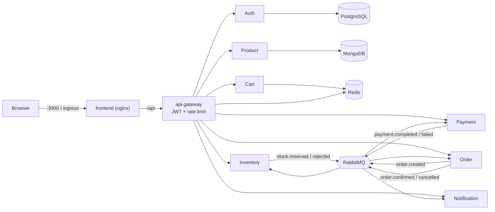
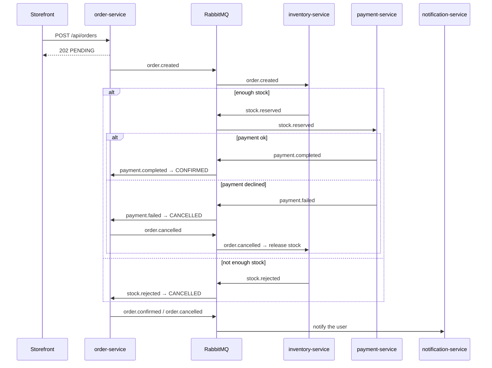
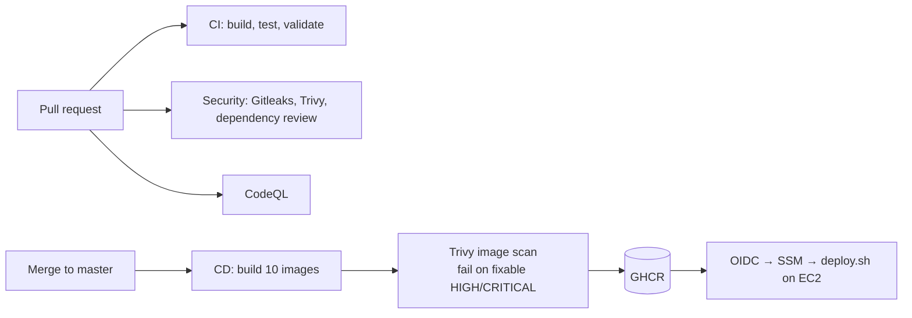

# ShopSphere

ShopSphere is a cloud-native e-commerce platform built for the CNA DevOps assignment. It has:

- eight Spring Boot microservices behind a JWT API gateway
- a browser storefront
- polyglot persistence (PostgreSQL, MongoDB, Redis)
- an event-driven order saga over RabbitMQ
- hardened Docker images and Kubernetes manifests (Kustomize)
- Terraform for a low-cost AWS environment
- GitHub Actions for CI, CD and security scanning

**Live demo:** http://3.7.14.126. It runs on AWS EC2 with k3s in ap-south-1 (Mumbai).

- The server stops every night at 23:00 IST to save credits. Start it again with the command from `terraform output -raw start_command`.
- If the environment is destroyed and re-created, the link changes. Use the new value of `terraform output app_url`.

    

---

## Contents

1. [What the application does](#what-the-application-does)
2. [Architecture](#architecture)
3. [Services](#services)
4. [The order saga](#the-order-saga)
5. [API reference](#api-reference)
6. [Technology stack](#technology-stack)
7. [Repository layout](#repository-layout)
8. [Run locally with Docker Compose](#run-locally-with-docker-compose)
9. [Run locally on Kubernetes (kind)](#run-locally-on-kubernetes-kind)
10. [Deploy to AWS](#deploy-to-aws)
11. [Take the AWS environment down](#take-the-aws-environment-down)
12. [Configuration](#configuration)
13. [CI/CD pipeline](#cicd-pipeline)
14. [DevSecOps and security controls](#devsecops-and-security-controls)
15. [Kubernetes design](#kubernetes-design)
16. [Observability](#observability)
17. [Testing](#testing)
18. [Troubleshooting](#troubleshooting)
19. [Cost](#cost)
20. [Assignment rubric mapping](#assignment-rubric-mapping)
21. [Further documentation](#further-documentation)

---

## What the application does

The storefront is a single-page app served by nginx. It has five areas:

| Area | What a user can do |
| --- | --- |
| **Shop** | Browse 12 seeded products, filter by category, search, see live stock counts, add items to the cart |
| **Cart** | Change quantities, remove items, check out (requires sign-in) |
| **Orders** | Watch each order move through the saga steps live (created, stock reserved, paid, confirmed or cancelled with the reason) |
| **Platform** | See the health of every service through the gateway |
| **Admin** | (admin only) Add products and set stock levels |

Users register with an email and password, or sign in as the seeded admin. A notification bell shows saga outcomes such as "Order confirmed" and "Payment declined".

Stock counts are shared by everyone. When one shopper buys an item, every open storefront shows the new count within about 5 seconds.

---

## Architecture



**Request path.**
1. The browser only talks to the frontend.
2. nginx serves the static files and proxies `/api/*` to the gateway.
3. The gateway validates the JWT, decides whether the route is public, user-only or admin-only, and strips any client-supplied `X-User-*` headers. It then forwards the request with trusted `X-User-Id` and `X-User-Role` headers.
4. The backend services trust only those headers, and only the gateway can reach them.

**Service discovery.** The services find each other by their Kubernetes or Compose DNS names, such as `http://product-service:8082`. There is no Eureka and no config server (see [ADR 0001](docs/adr/0001-kubernetes-native-discovery.md) and [ADR 0002](docs/adr/0002-no-config-server.md)).

**Synchronous and asynchronous communication.**
- Reads and simple writes are REST calls through the gateway.
- Anything that spans several services, which is placing an order, is a choreographed saga over RabbitMQ topic exchanges (see [ADR 0003](docs/adr/0003-messaging-boundary.md)).

**Shared library.** `common-lib` holds:
- the event contracts (`OrderEvents`)
- the JWT helper
- a correlation-id filter, so one id follows a request through every log line
- a common JSON error handler

More detail is in [docs/architecture.md](docs/architecture.md) and [docs/patterns.md](docs/patterns.md).

---

## Services

| Service | Port | Responsibility | Store |
| --- | --- | --- | --- |
| `frontend` | 8080 (3000 on the host) | Storefront SPA served by nginx; proxies `/api` to the gateway; CSP and security headers | none |
| `api-gateway` | 8080 | Spring Cloud Gateway: single entry point; JWT validation; USER/ADMIN access rules; header-spoofing protection; Redis rate limiting on `/api/auth` (5 requests/s, burst 10, per client IP) | Redis |
| `auth-service` | 8081 | Register, login, `/me`; BCrypt password hashes; signs JWTs; seeds the admin account | PostgreSQL |
| `product-service` | 8082 | Catalogue search, categories, admin CRUD; seeds 12 demo products | MongoDB |
| `inventory-service` | 8083 | Stock levels; reserves stock on `order.created`; releases it on `order.cancelled` (compensation); idempotent per order id | MongoDB (`inventory_db`) |
| `cart-service` | 8084 | Per-user cart with a 7-day TTL | Redis |
| `order-service` | 8085 | Prices orders from the catalogue, starts the saga, tracks status and step history | MongoDB (`order_db`) |
| `payment-service` | 8086 | Mock card charge with Resilience4j retry and circuit breaker; declines orders above ₹50,000 so the failure path can be shown | none |
| `notification-service` | 8087 | Turns saga outcomes into per-user notifications | MongoDB (`notification_db`) |
| `report-job` | none | Batch job run as a Kubernetes CronJob (01:30 daily) that writes a daily sales report line | none |
| `common-lib` | n/a | Shared event contracts, JWT helper, correlation-id filter, error handler | n/a |

Seeded stock: every product starts at 25 units, except every fourth product, which starts at 3 so "Only N left" and "Sold out" are easy to demonstrate. Users (PostgreSQL), products, stock, orders and notifications (MongoDB) and carts (Redis, append-only file) are all stored on persistent volumes, so they survive pod restarts and an instance stop and start. Each service has its own database, and NetworkPolicies let only the owning services reach each datastore.

---

## The order saga



How to demonstrate each path from the storefront:

| Path | How to trigger it | Result |
| --- | --- | --- |
| Happy path | Order a few in-stock items | `CONFIRMED`, and stock goes down |
| Out of stock | Order more units than are left | `CANCELLED`: "Insufficient stock" |
| Payment declined + compensation | Order more than ₹50,000 in total | `CANCELLED`, and the reserved stock is released back |

---

## API reference

All routes go through the gateway (`http://localhost:8080` with Compose, or `/api` on the public link).

| Method | Path | Access | Description |
| --- | --- | --- | --- |
| POST | `/api/auth/register` | public | Create a user, returns a JWT |
| POST | `/api/auth/login` | public | Sign in, returns a JWT |
| GET | `/api/auth/me` | user | Current user |
| GET | `/api/products` | public | List or search products |
| GET | `/api/products/categories` | public | List categories |
| GET | `/api/products/{id}` | public | One product |
| POST / PUT / DELETE | `/api/products[/{id}]` | admin | Create, update, delete products |
| GET | `/api/inventory` | public | Stock for every SKU |
| GET | `/api/inventory/{sku}` | public | Stock for one SKU |
| PUT | `/api/inventory/{sku}?quantity=N` | admin | Set stock |
| GET | `/api/carts` | user | Current cart |
| POST | `/api/carts/items` | user | Add an item |
| PUT / DELETE | `/api/carts/items/{productId}` | user | Change or remove an item |
| DELETE | `/api/carts` | user | Empty the cart |
| POST | `/api/orders` | user | Place an order (returns `202`) |
| GET | `/api/orders` | user | My orders |
| GET | `/api/orders/{id}` | user | One order with saga history |
| GET | `/api/payments/policy` | public | Card limit used by the mock processor |
| GET | `/api/notifications` | user | My notifications |

Send the token as `Authorization: Bearer <jwt>`. Example:

```bash
TOKEN=$(curl -s -X POST localhost:8080/api/auth/login -H 'Content-Type: application/json' \
  -d '{"email":"admin@shopsphere.local","password":"Admin@12345"}' | jq -r .accessToken)
curl -s localhost:8080/api/auth/me -H "Authorization: Bearer $TOKEN"
```

---

## Technology stack

| Layer | Technology |
| --- | --- |
| Language / framework | Java 21, Spring Boot 4.0, Spring Cloud Gateway, Spring AMQP, Spring Data JPA / MongoDB / Redis, Resilience4j |
| Frontend | Vanilla JavaScript SPA, nginx (unprivileged image) |
| Data | PostgreSQL 16, MongoDB 7, Redis 7 |
| Messaging | RabbitMQ 3 (topic exchange, durable queues) |
| Build | Maven multi-module, JaCoCo coverage |
| Containers | Multi-stage Dockerfile with Spring Boot layered jars, non-root user, BuildKit cache |
| Orchestration | Kubernetes with Kustomize; kind for local, k3s on EC2 for AWS; Traefik ingress |
| IaC | Terraform (AWS provider): EC2, EIP, IAM, SSM, OIDC, Budgets, EventBridge Scheduler |
| CI/CD | GitHub Actions, GHCR, AWS SSM Run Command via GitHub OIDC |
| Security | Gitleaks, Trivy (filesystem, IaC, images), CodeQL, Dependency Review |
| Observability | Spring Boot Actuator, Prometheus, Grafana, correlation ids |
| Testing | JUnit 5, Mockito, k6 load test, smoke test scripts, chaos script |

---

## Repository layout

```
common-lib/                 shared event contracts, JWT helper, web/messaging auto-configuration
services/
  api-gateway/              gateway routes, JWT filter, access policy, rate limiter
  auth-service/             users, BCrypt, JWT issuing (PostgreSQL)
  product-service/          catalogue (MongoDB)
  inventory-service/        stock ledger and saga listener
  cart-service/             carts (Redis)
  order-service/            orders and saga orchestration state
  payment-service/          mock payments with retry / circuit breaker
  notification-service/     user notifications
  report-job/               nightly batch job (CronJob)
frontend/
  public/                   index.html, app.js, styles.css
  nginx/                    nginx config template (proxy, CSP, caching)
  Dockerfile
Dockerfile                  shared multi-stage build for every Java service (MODULE build arg)
docker-compose.yml          full stack with healthchecks and memory limits
docker-compose.observability.yml   optional Prometheus + Grafana
k8s/
  base/                     namespace, config, datastores, apps, HPAs, PDBs, NetworkPolicies, CronJob
  overlays/local/           kind: local images, NodePort 30080
  overlays/aws/             k3s: GHCR images, Traefik Ingress, generated secrets
infra/terraform/            AWS infrastructure (see infra/terraform/README.md)
.github/workflows/          ci.yml, cd.yml, security.yml, codeql.yml, terraform.yml
scripts/                    kind, deploy, smoke, chaos, load and AWS diagnose helpers
load-tests/                 k6 scenario
observability/              Prometheus configuration
monolith/                   placeholder baseline for a monolith vs microservices comparison
docs/                       architecture, patterns, cost, threat model, reliability, ADRs, demo script
Makefile                    shortcuts (make help)
```

---

## Run locally with Docker Compose

**Requirements:** Docker Desktop with about 3 GB of free RAM. Java and Maven are not needed, because the images build inside Docker.

```bash
git clone https://github.com/DSheth2004/shopsphere-cloud-native.git
cd shopsphere-cloud-native
cp .env.example .env          # optional; the defaults work for local use
docker compose up --build -d  # or: make up   (first build takes a few minutes)
docker compose ps             # wait until every service is healthy
```

Open **http://localhost:3000**.

- **Admin:** `admin@shopsphere.local` / `Admin@12345` (the value of `ADMIN_PASSWORD` in `.env`). The Admin tab lets you add products and change stock.
- **Shopper:** register any email and password.

| URL | What |
| --- | --- |
| http://localhost:3000 | Storefront |
| http://localhost:8080/actuator/health | Gateway health |
| http://localhost:15672 | RabbitMQ console (user and password from `.env`) |

Useful commands:

```bash
docker compose logs -f order-service    # follow one service
bash scripts/smoke-test.sh              # end-to-end check (Windows: powershell -File scripts/smoke-test.ps1)
docker compose down -v                  # stop and delete volumes (or: make down)
```

---

## Run locally on Kubernetes (kind)

**Requirements:** Docker, [kind](https://kind.sigs.k8s.io/) and kubectl.

```bash
bash scripts/kind-up.sh            # Windows: powershell -File scripts/kind-up.ps1   (or: make kind-up)
kubectl -n shopsphere get pods
```

The script:
1. creates the cluster from `scripts/kind-config.yaml`
2. builds every image and loads it into kind
3. applies `k8s/overlays/local`
4. waits for every rollout

Open **http://localhost:30080**. Delete the cluster with `kind delete cluster --name shopsphere` (or `make kind-down`).

Try the self-healing: `bash scripts/chaos.sh` deletes the gateway pod and watches Kubernetes replace it.

---

## Deploy to AWS

Terraform in [`infra/terraform`](infra/terraform) creates one small, cost-controlled environment in the default VPC:

- one `c7i-flex.large` EC2 instance (2 vCPU, 4 GiB, allowed on the AWS Free plan) running Amazon Linux 2023 and k3s, with an encrypted gp3 disk and IMDSv2
- an Elastic IP, so the public link survives stop and start
- a security group with only HTTP 80 open (SSH is optional and off by default)
- an instance role for SSM Session Manager, so no SSH keys are needed
- a random admin password stored as an SSM SecureString
- a GitHub OIDC provider and a deploy role that can only run the deploy command on this instance
- an AWS Budget with email alerts, and an EventBridge Scheduler that stops the instance every night at 23:00 IST

There is no NAT gateway, load balancer, EKS, RDS or ElastiCache.

### Prerequisites

1. Install [Terraform](https://developer.hashicorp.com/terraform/install) 1.6 or later and the [AWS CLI](https://aws.amazon.com/cli/).
2. Create an access key for an IAM user (IAM, Users, Security credentials, Create access key), then run `aws configure` with region `ap-south-1`.
3. Check that the container images exist on GHCR and are **public**. The CD workflow pushes them on every merge to `master`, and each `shopsphere-*` package needs its visibility set to Public (GitHub, Packages, Package settings). The node pulls them anonymously.

### Create the environment

```powershell
cd infra/terraform
copy terraform.tfvars.example terraform.tfvars   # macOS/Linux: cp; then set budget_email
terraform init
terraform apply                                  # type "yes"
terraform output app_url                         # the public link
terraform output -raw admin_password | Set-Clipboard   # admin@shopsphere.local (macOS: | pbcopy)
```

**Yes, `terraform apply` starts everything automatically.** On first boot, the instance's user-data script:
1. adds 2 GB of swap
2. installs k3s
3. generates fresh cluster secrets (JWT key and database passwords) and reads the admin password from SSM
4. clones this repository
5. installs `/opt/shopsphere/deploy.sh`
6. deploys `k8s/overlays/aws`

Nothing has to be run by hand. Give it **about 8 to 10 minutes** after `apply` finishes before opening the link. A "404" or "Bad Gateway" in the first few minutes means pods are still starting.

After a fresh apply:
- the **IP address and link are new**
- the **admin password is new** (read it again with `terraform output -raw admin_password`)
- the **instance id is new**, so update the GitHub variables below if you use them

### Day-to-day commands

Run these from `infra/terraform`:

```powershell
terraform output                                   # every output
Invoke-Expression (terraform output -raw stop_command)    # stop the instance (saves credits)
Invoke-Expression (terraform output -raw start_command)   # start it again; the link stays the same
Invoke-Expression (terraform output -raw shell_command)   # open a shell on the node through SSM
```

On macOS or Linux, use `$(terraform output -raw stop_command)` instead.

After a start, the pods take a few minutes to become ready again. Users, orders, stock, notifications and carts are kept on the instance's disk, so they are still there.

### Redeploy after a code change

**Automatic.** Set two repository variables in GitHub (Settings, Secrets and variables, Actions, Variables):

| Variable | Value |
| --- | --- |
| `AWS_DEPLOY_ROLE_ARN` | `terraform output -raw github_deploy_role_arn` |
| `EC2_INSTANCE_ID` | `terraform output -raw instance_id` |

From then on, every merge to `master` builds, scans and pushes the images, then runs `/opt/shopsphere/deploy.sh` on the node through SSM. No AWS keys are stored in GitHub.

**By hand.** After the CD workflow has pushed new images, run from `infra/terraform`:

```powershell
# full redeploy (pulls the latest manifests and restarts every deployment)
aws ssm send-command --region ap-south-1 --instance-ids (terraform output -raw instance_id) --document-name AWS-RunShellScript --parameters "commands=/opt/shopsphere/deploy.sh"

# or restart only the storefront
aws ssm send-command --region ap-south-1 --instance-ids (terraform output -raw instance_id) --document-name AWS-RunShellScript --parameters "commands=k3s kubectl -n shopsphere rollout restart deployment/frontend"
```

---

## Take the AWS environment down

When you are finished, for example after grading, delete everything Terraform created:

```powershell
cd infra/terraform
terraform destroy          # review the plan, then type "yes"
```

This removes:
- the EC2 instance and its disk, along with everything inside k3s (databases, pods, secrets)
- the Elastic IP and security group
- the IAM roles and the GitHub OIDC provider
- the SSM parameter, budget and scheduler

AWS charges stop once it completes. It takes a few minutes.

Things `destroy` does not touch:
- the container images on GHCR (free)
- your local `terraform.tfvars`
- the GitHub repository variables (delete them, or CD will try to deploy to an instance that no longer exists)

To bring the environment back later, run `terraform apply` again (see above).

If you only want to pause spending for a few days, stopping the instance is enough (about $0.20/day while stopped, versus about $1.30/day running).

---

## Configuration

### Local (`.env`, read by Docker Compose)

| Variable | Default | Purpose |
| --- | --- | --- |
| `JWT_SECRET` | sample value | HMAC key for signing JWTs (32 bytes minimum) |
| `ADMIN_PASSWORD` | `Admin@12345` | Password of the seeded `admin@shopsphere.local` account |
| `POSTGRES_PASSWORD` | sample value | auth-service database |
| `RABBITMQ_DEFAULT_USER` / `RABBITMQ_DEFAULT_PASS` | `shopsphere` / sample | Broker credentials |
| `PAYMENT_FAILURE_RATE` | `0` | Fraction (0 to 1) of payments that fail at random, to exercise retries and the circuit breaker |

`PAYMENT_CARD_LIMIT` (default `50000`) sets the order total above which payment is declined.

### Kubernetes

- Non-secret settings live in the `shopsphere-config` ConfigMap (`k8s/base/config.yaml`).
- Secrets come from a Kustomize `secretGenerator`.
  - On AWS, `secrets.env` is generated on the node at first boot and never leaves it.
  - For local renders, `k8s/overlays/aws/secrets.env.example` shows the keys.

### Terraform (`terraform.tfvars`)

| Variable | Default | Purpose |
| --- | --- | --- |
| `budget_email` | required | Where budget alerts go |
| `aws_region` | `ap-south-1` | Region |
| `instance_type` | `c7i-flex.large` | Node size (4 GiB is the practical minimum) |
| `root_volume_gb` | `20` | Disk size |
| `git_branch` | `master` | Branch the node deploys |
| `budget_limit_usd` | `80` | Monthly budget |
| `nightly_stop_enabled` / `nightly_stop_cron` / `nightly_stop_timezone` | `true` / 23:00 / `Asia/Kolkata` | Automatic nightly stop |
| `ssh_cidr` | empty (SSH closed) | Optional CIDR allowed to SSH |
| `create_github_oidc_provider` | `true` | Set to `false` if the account already has GitHub's OIDC provider |

Never commit `terraform.tfvars`, `terraform.tfstate`, `.env` or `secrets.env`; `.gitignore` already excludes them.

---

## CI/CD pipeline



| Workflow | Trigger | What it does |
| --- | --- | --- |
| `ci.yml` | push, PR | Maven `verify` with unit tests and JaCoCo coverage; frontend syntax check; `docker compose config`; Kustomize render of both overlays plus `kubeconform` schema validation; sample Docker builds on PRs |
| `security.yml` | push, PR, weekly | Gitleaks secret scan; Trivy dependency scan (fails on fixable HIGH/CRITICAL); Trivy IaC scan of Dockerfiles, Kubernetes and Terraform with SARIF upload to GitHub code scanning; dependency review on PRs |
| `codeql.yml` | push, PR, weekly | CodeQL static analysis for Java and JavaScript |
| `cd.yml` | push to `master`/`main`, manual | Builds all 10 images, scans each with Trivy, pushes `latest` and `sha-<commit>` tags to GHCR, then deploys to EC2 through SSM when the AWS variables are set |
| `terraform.yml` | changes in `infra/` | `terraform fmt -check`, `init`, `validate` |

Branch workflow: work on a feature branch, open a PR, and merge when every check is green (see [docs/git-workflow.md](docs/git-workflow.md)).

---

## DevSecOps and security controls

**In the pipeline**
- **Secrets:** Gitleaks on every push. `.gitleaks.toml` allowlists only test fixtures.
- **Dependencies:** Trivy filesystem scan, plus Dependency Review on PRs. Patched versions are pinned in the parent `pom.xml`.
- **Images:** Trivy scan of every image before it is pushed.
- **IaC:** Trivy config scan. `.trivyignore` lists only checks that cannot apply here, each with a reason.
- **Code:** CodeQL for Java and JavaScript.

**In the application**
- JWT validation at the gateway, with USER/ADMIN route rules.
- The gateway strips client-supplied `X-User-*` headers, so they can't be spoofed.
- BCrypt password hashing.
- Rate limiting on the auth endpoints.
- Content-Security-Policy and other security headers on the frontend.

**In the runtime**
- Containers run as non-root with a read-only root filesystem, all Linux capabilities dropped, and seccomp `RuntimeDefault`.
- The namespace enforces Pod Security Standards `restricted`.
- Default-deny NetworkPolicies, with explicit allows between services.

**In the cloud**
- No AWS keys in GitHub: deployment uses OIDC with a role scoped to one instance and one SSM document.
- IMDSv2 required, encrypted disk.
- Only port 80 is open inbound, and outbound is limited to 80/443.
- The admin password is kept in SSM SecureString.

See [docs/threat-model.md](docs/threat-model.md) and [docs/compliance.md](docs/compliance.md).

---

## Kubernetes design

`k8s/base` uses:

- Deployments with readiness, liveness and startup probes on Actuator health endpoints
- resource requests and limits on every container
- HorizontalPodAutoscalers for the gateway and frontend (1 to 3 replicas at 70% CPU)
- PodDisruptionBudgets
- a CronJob for `report-job`
- a ConfigMap, plus Secrets from a Kustomize `secretGenerator`
- default-deny NetworkPolicies with per-service allow rules
- the `shopsphere` namespace labelled for Pod Security Standards `restricted`
- `enableServiceLinks: false`, so Kubernetes-injected variables such as `REDIS_PORT=tcp://...` cannot override application settings

There are two overlays:
- **`local`** (kind): local images and a NodePort on 30080.
- **`aws`** (k3s): GHCR images with `imagePullPolicy: Always`, and a Traefik Ingress on port 80.

---

## Observability

- Every service exposes `/actuator/health` and `/actuator/prometheus`.
- The storefront's **Platform** page shows live health for each service.
- Every request carries an `x-request-id` correlation id. It is generated when missing, returned in the response and logged by every service, so one order can be followed across all logs.
- Optional Prometheus and Grafana:

  ```bash
  docker compose -f docker-compose.yml -f docker-compose.observability.yml up -d
  ```

  Prometheus runs on http://localhost:9090 and Grafana on http://localhost:3001.

---

## Testing

| What | Command |
| --- | --- |
| Unit tests | `mvn -B test` (or `make test`) |
| Unit tests + coverage | `mvn -B verify`, reports in `*/target/site/jacoco` |
| End-to-end smoke test | `bash scripts/smoke-test.sh` / `powershell -File scripts/smoke-test.ps1` |
| Load test (k6) | `k6 run -e BASE_URL=http://localhost:3000 load-tests/order-flow.js` (or `make load`); ramps to 30 virtual users; thresholds: <2% errors, p95 <800 ms |
| Chaos | `bash scripts/chaos.sh` / `scripts/chaos.ps1` deletes the gateway pod and watches recovery |
| Manifests | `make k8s-validate` |
| Terraform | `make tf-validate` |
| Vulnerability scan | `make scan` (needs Trivy installed) |

---

## Troubleshooting

| Symptom | Likely cause and fix |
| --- | --- |
| AWS link shows **404** or **Bad Gateway** right after apply or start | Pods are still starting; wait a few minutes. Run `powershell -File scripts/aws-diagnose.ps1` to print pod status, an admin login check and recent logs through SSM |
| AWS link does not load at all | The instance is stopped (nightly stop). Run the start command |
| Admin login fails on AWS | The password is not `Admin@12345` on AWS. Copy it with `terraform output -raw admin_password \| Set-Clipboard` and paste it |
| `terraform apply` says the instance type is not eligible | On the AWS Free plan, keep `instance_type = "c7i-flex.large"` (or another free-plan type with at least 4 GiB) |
| Pods stuck in `ImagePullBackOff` on AWS | The GHCR packages are private; make each `shopsphere-*` package public |
| Order stays `PENDING` | RabbitMQ or a saga service is not ready yet; check `docker compose ps` or `kubectl -n shopsphere get pods` |
| Stock or orders reset | Data lives on the instance's disk and survives stop/start; only `terraform destroy` (or deleting the PVCs) removes it |
| Compose services restart repeatedly | Docker Desktop needs about 3 GB of free memory |

---

## Cost

| | Approx. cost |
| --- | --- |
| Running | about $1.30/day |
| Stopped | about $0.20/day (Elastic IP and disk) |
| Destroyed | $0 |

The nightly stop and the $80 budget alerts keep the credit safe. See [docs/COST.md](docs/COST.md).

---

## Assignment rubric mapping

| Criterion | Where to look |
| --- | --- |
| Microservices (3) | `services/*`, `common-lib`; saga across `order-service`, `inventory-service` and `payment-service`; gateway in `api-gateway` |
| Docker (4) | Multi-stage `Dockerfile` (layered jars, non-root, BuildKit cache); `frontend/Dockerfile`; `docker-compose.yml` with healthchecks and memory limits |
| IaC (2) | `infra/terraform` (EC2 + k3s, IAM, OIDC, budgets, scheduler) |
| Kubernetes (2) | `k8s/base`, `k8s/overlays/local`, `k8s/overlays/aws`, `scripts/kind-up.*` |
| CI/CD pipeline (3) | `.github/workflows/ci.yml`, `cd.yml`, `terraform.yml` |
| DevSecOps (2) | `.github/workflows/security.yml`, `codeql.yml`; Trivy image scan in `cd.yml`; hardened manifests |
| Cloud provider / local machine (2) | AWS EC2 via Terraform; local Docker Compose and kind |
| Public link (2) | http://3.7.14.126 (`terraform output app_url`) |

---

## Further documentation

| Document | Contents |
| --- | --- |
| [docs/architecture.md](docs/architecture.md) | Detailed architecture |
| [docs/patterns.md](docs/patterns.md) | Microservice patterns used and why |
| [docs/reliability.md](docs/reliability.md) | Probes, retries, circuit breaker, autoscaling, chaos |
| [docs/threat-model.md](docs/threat-model.md) | Threats and mitigations |
| [docs/compliance.md](docs/compliance.md) | Security controls checklist |
| [docs/COST.md](docs/COST.md) | AWS cost estimate and controls |
| [docs/demo-script.md](docs/demo-script.md) | Step-by-step demo walkthrough |
| [docs/git-workflow.md](docs/git-workflow.md) | Branch and PR conventions |
| [docs/adr/](docs/adr/README.md) | Architecture decision records |
| [infra/terraform/README.md](infra/terraform/README.md) | Terraform details |
