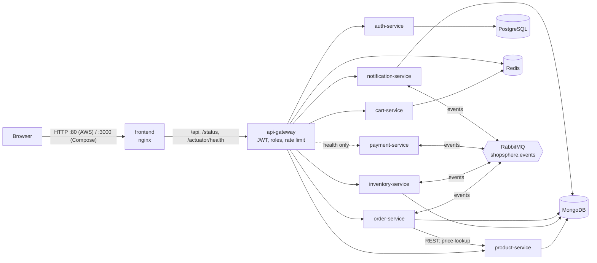
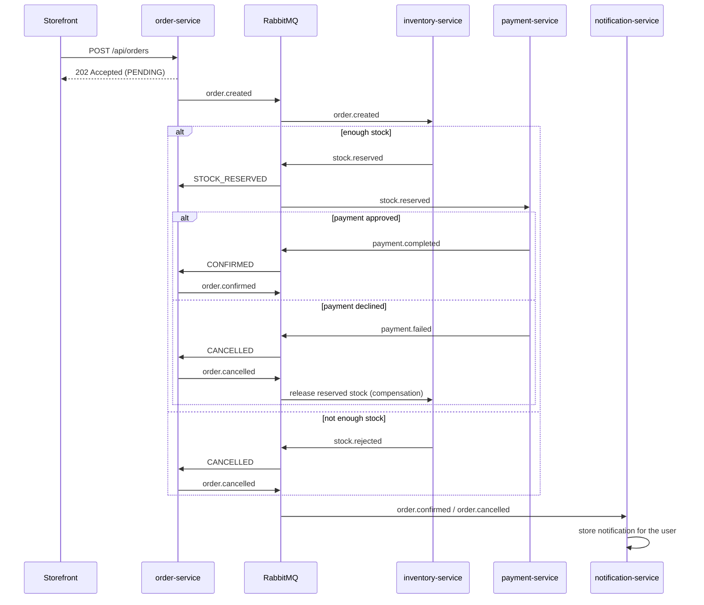
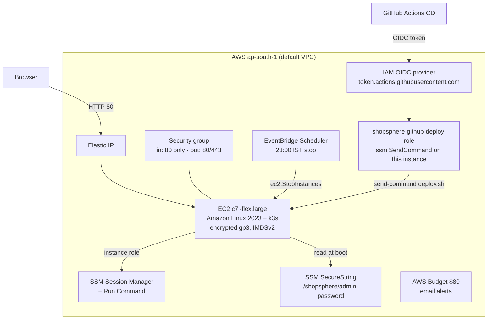

# ShopSphere

ShopSphere is a cloud-native e-commerce platform built for the CNA DevOps assignment. A shopper can browse a catalogue, fill a cart and place an order; the order is then processed by several independent services that talk to each other through events. Around that application sits the full DevOps toolchain: container images, Kubernetes manifests, Terraform for AWS, and GitHub Actions pipelines with security scanning built in.

**Live demo: http://3.7.14.126** (AWS EC2 + k3s, region ap-south-1 Mumbai)

> The server is stopped automatically every night at 23:00 IST to save credits. If the link does not load, start it with the command from `terraform output -raw start_command` and wait a few minutes for the pods. If the environment is ever destroyed and re-created, the IP changes; the new link is `terraform output app_url`.

      

---

## Grading quick index

Each assessment criterion, where it is explained in this README, and the files that implement it.

| Criterion | Section in this README | Files in the repository |
| --- | --- | --- |
| **Microservices** | [1. Microservices](#1-microservices) | `services/*`, `common-lib/` |
| **Docker** | [2. Docker](#2-docker) | `Dockerfile`, `frontend/Dockerfile`, `.dockerignore`, `docker-compose.yml`, `docker-compose.observability.yml` |
| **IaC** | [3. Infrastructure as Code (Terraform)](#3-infrastructure-as-code-terraform) | `infra/terraform/*` |
| **Kubernetes** | [4. Kubernetes](#4-kubernetes) | `k8s/base/*`, `k8s/overlays/local/*`, `k8s/overlays/aws/*` |
| **CI/CD pipeline** | [5. CI/CD pipeline](#5-cicd-pipeline-github-actions) | `.github/workflows/ci.yml`, `cd.yml`, `terraform.yml` |
| **DevSecOps** | [6. DevSecOps](#6-devsecops) | `.github/workflows/security.yml`, `codeql.yml`, `dast.yml`, `.gitleaks.toml`, `.trivyignore`, `.zap/rules.tsv` |
| **Cloud provider** | [7. Cloud provider (AWS)](#7-cloud-provider-aws) | `infra/terraform/*`, `k8s/overlays/aws/*`, `cd.yml` (deploy job) |
| **Public link** | [8. Public link](#8-public-link) | http://3.7.14.126 (`terraform output app_url`) |

---

## Contents

- [What the application does](#what-the-application-does)
- [Architecture at a glance](#architecture-at-a-glance)
- [1. Microservices](#1-microservices)
  - [Shared library: common-lib](#shared-library-common-lib)
  - [api-gateway](#api-gateway)
  - [auth-service](#auth-service)
  - [product-service](#product-service)
  - [inventory-service](#inventory-service)
  - [cart-service](#cart-service)
  - [order-service](#order-service)
  - [payment-service](#payment-service)
  - [notification-service](#notification-service)
  - [report-job](#report-job)
  - [The order saga](#the-order-saga)
  - [API reference](#api-reference)
- [Frontend (storefront)](#frontend-storefront)
- [Backing services (data and messaging)](#backing-services-data-and-messaging)
- [2. Docker](#2-docker)
- [3. Infrastructure as Code (Terraform)](#3-infrastructure-as-code-terraform)
- [4. Kubernetes](#4-kubernetes)
- [5. CI/CD pipeline (GitHub Actions)](#5-cicd-pipeline-github-actions)
- [6. DevSecOps](#6-devsecops)
- [7. Cloud provider (AWS)](#7-cloud-provider-aws)
- [8. Public link](#8-public-link)
- [Observability](#observability)
- [Testing](#testing)
- [Scripts and Makefile](#scripts-and-makefile)
- [How to run it](#how-to-run-it)
- [Configuration reference](#configuration-reference)
- [Troubleshooting](#troubleshooting)
- [Cost](#cost)
- [Repository layout](#repository-layout)
- [Further documentation](#further-documentation)

---

## What the application does

The storefront is a single-page web app with five areas:

| Area | What a user can do |
| --- | --- |
| **Shop** | Browse 12 seeded products, filter by category, search by name, see live stock counts ("Only 3 left", "Sold out"), add items to the cart |
| **Cart** | Change quantities, remove items, check out (sign-in required) |
| **Orders** | Watch each order move through the saga steps live: placed, stock reserved, payment captured, confirmed, or cancelled with a reason |
| **Platform** | See the live health of every backend service, read through the gateway |
| **Admin** | (admin only) Add products and set stock levels |

Users register with a name, email and password, or sign in as the seeded admin (`admin@shopsphere.local`). A notification bell shows saga outcomes such as "Order confirmed" or "Order cancelled: Card declined".

Stock is shared by every shopper. When one person buys an item, every open storefront shows the new count within about 5 seconds.

---

## Architecture at a glance



How a request flows:

1. The browser only ever talks to the **frontend** (nginx). nginx serves the static files and reverse-proxies `/api/*`, `/status/*` and `/actuator/health` to the gateway. It also stamps every proxied request with an `X-Request-Id`.
2. The **api-gateway** decides whether the route is public, user-only or admin-only, validates the JWT, removes any `X-User-Id` / `X-User-Role` headers the client tried to send, and adds trusted ones taken from the token.
3. The **backend services** read the caller's identity only from those trusted headers. NetworkPolicies make sure only the gateway can reach them, so the headers cannot be forged from outside.
4. Anything that spans several services (placing an order) is a **saga**: a chain of events over RabbitMQ rather than a chain of HTTP calls.

Design choices are recorded as ADRs: services find each other through plain Kubernetes / Compose DNS names, with no Eureka ([ADR 0001](docs/adr/0001-kubernetes-native-discovery.md)); configuration comes from environment variables, ConfigMaps and Secrets, with no Spring Cloud Config server ([ADR 0002](docs/adr/0002-no-config-server.md)); and REST is used for reads while events are used for cross-service workflows ([ADR 0003](docs/adr/0003-messaging-boundary.md)).

---

## 1. Microservices

The backend is a Maven multi-module project (`pom.xml` at the root) with one shared library and nine Spring Boot applications. Each one is built into its own container image and deployed as its own Kubernetes Deployment, so each can be released, scaled and restarted on its own.

| Module | Type | Responsibility | Data store | Talks to |
| --- | --- | --- | --- | --- |
| `common-lib` | library | Event contracts, JWT helper, correlation ids, error format, RabbitMQ setup | none | used by every service |
| `api-gateway` | Spring Cloud Gateway (reactive) | Single entry point, routing, JWT checks, roles, rate limiting | Redis (rate-limit counters) | every service |
| `auth-service` | REST | Registration, login, profile, issuing JWTs, seeding the admin | PostgreSQL | none |
| `product-service` | REST | Catalogue: list, search, categories, admin create/update/delete | MongoDB `product_db` | none |
| `inventory-service` | REST + saga participant | Stock levels and per-order reservations | MongoDB `inventory_db` | RabbitMQ |
| `cart-service` | REST | One cart per user | Redis | none |
| `order-service` | REST + saga coordinator | Prices and stores orders, starts the saga, tracks status | MongoDB `order_db` | product-service (REST), RabbitMQ |
| `payment-service` | saga participant | Mock card charge with retry and circuit breaker | none (stateless) | RabbitMQ |
| `notification-service` | REST + saga listener | Turns final order outcomes into user notifications | MongoDB `notification_db` | RabbitMQ |
| `report-job` | batch job | Runs nightly as a Kubernetes CronJob and exits | none | none |

Every service listens on port **8080 inside its container** (the Dockerfile sets `SERVER_PORT=8080`). When run directly from an IDE without Docker, each falls back to its own default port: gateway 8080, auth 8081, product 8082, inventory 8083, cart 8084, order 8085, payment 8086, notification 8087.

Every service also exposes `/actuator/health` (with Kubernetes liveness and readiness groups) and `/actuator/prometheus`, and shuts down gracefully so in-flight requests finish during a rollout.

### Shared library: common-lib

`common-lib` is a plain jar that every service depends on. It is wired in through Spring Boot auto-configuration (`META-INF/spring/org.springframework.boot.autoconfigure.AutoConfiguration.imports`), so a service gets these features just by having the dependency.

| Class | What it does |
| --- | --- |
| `events/OrderEvents` | The saga contract: the exchange name `shopsphere.events`, the seven routing keys (`order.created`, `stock.reserved`, `stock.rejected`, `payment.completed`, `payment.failed`, `order.confirmed`, `order.cancelled`) and one Java record per event. Every event carries the order id and a correlation id. |
| `events/DomainEvent` | Generic event metadata record (event id, type, aggregate id, correlation id, timestamp). |
| `security/JwtTokens` | Issues and verifies HS256 JWTs with issuer `shopsphere-auth`, subject = user email, and a `role` claim. Refuses to start if `JWT_SECRET` is shorter than 32 bytes. Used by auth-service (to issue) and the gateway (to verify). |
| `web/CorrelationIdFilter` | Reads `x-request-id` (or generates a UUID), puts it in the logging MDC as `correlationId` and echoes it in the response, so one request can be followed through every log. |
| `web/GlobalExceptionHandler` | Maps exceptions to consistent JSON errors: `IllegalArgumentException` → 400, `NoSuchElementException` → 404, `IllegalStateException` → 409, missing `X-User-Id` header → 401, bean validation failures → 400 with per-field messages. No stack traces reach the client. |
| `api/ApiError` | The error body: timestamp, status, code, message, correlation id, field errors. |
| `config/ShopSphereMessagingAutoConfiguration` | When RabbitMQ is on the classpath, declares the durable topic exchange `shopsphere.events` and a JSON message converter restricted to the `com.shopsphere.common.events` package. |
| `config/ShopSphereWebAutoConfiguration` | In servlet (non-reactive) services, registers the correlation-id filter and the error handler. |

### api-gateway

Path: `services/api-gateway`. Built on **Spring Cloud Gateway** (reactive WebFlux).

- **Routing** (`application.yml`): `/api/auth/**` → auth-service, `/api/products/**` → product-service, `/api/inventory/**` → inventory-service, `/api/carts/**` → cart-service, `/api/orders/**` → order-service, `/api/notifications/**` → notification-service. Target URLs come from environment variables such as `AUTH_SERVICE_URL`, set by Compose or the `shopsphere-config` ConfigMap.
- **Health fan-out**: `GET /status/{auth,product,inventory,cart,order,payment,notification}` is rewritten to that service's `/actuator/health`. The storefront's Platform page uses these.
- **Access rules** (`AccessPolicy.java`): carts, orders, notifications and `/api/auth/me` need a signed-in user; any non-GET call to products or inventory needs the `ADMIN` role; everything else is public. The class has no framework dependencies so it is unit-tested directly.
- **JWT filter** (`JwtAuthenticationFilter.java`): a global filter that runs first. It verifies the `Authorization: Bearer` token, returns 401 ("Please sign in to continue") or 403 ("Administrator role required") as JSON, **strips any client-supplied `X-User-Id` / `X-User-Role` headers**, then sets them from the verified token.
- **Rate limiting**: the `/api/auth/**` route uses Spring Cloud Gateway's Redis `RequestRateLimiter` at 5 requests per second with a burst of 10, keyed by client IP (first `X-Forwarded-For` hop, set by nginx / Traefik). This slows down password guessing.
- **Hardening**: removes the `X-Powered-By` response header; graceful shutdown; in Kubernetes a `preStop` sleep of 5 s lets the endpoint drain before the pod stops.

### auth-service

Path: `services/auth-service`. **Spring MVC + Spring Data JPA on PostgreSQL.**

- `POST /api/auth/register`: validates name (≤ 60), email and password (8 to 72 characters), lower-cases the email, rejects duplicates (409), stores a **BCrypt** hash, and returns a session.
- `POST /api/auth/login`: checks the BCrypt hash and returns a session, or 400 "Invalid email or password" (the same message for an unknown email and a wrong password).
- `GET /api/auth/me`: returns the profile for the `X-User-Id` set by the gateway.
- A session is `{ accessToken, tokenType: "Bearer", expiresIn, user: { email, name, role } }`. Tokens last 8 hours (`shopsphere.jwt.ttl`).
- `UserAccount` is a JPA entity in table `users` (email as primary key, display name, password hash, role, created-at). The schema is created by Hibernate (`ddl-auto: update`).
- `AdminSeeder` creates `admin@shopsphere.local` with role `ADMIN` on first start, using `ADMIN_PASSWORD` from the environment. If that variable is empty it logs a warning and creates no admin, so no default password ships in code.

### product-service

Path: `services/product-service`. **Spring MVC + Spring Data MongoDB.**

- `GET /api/products` lists the catalogue sorted by name; `?q=` searches names (case-insensitive) and `?category=` filters.
- `GET /api/products/categories` returns the distinct categories; `GET /api/products/{id}` returns one product or 404.
- `POST`, `PUT /{id}`, `DELETE /{id}` manage products (admin only, enforced at the gateway). New products get an id like `SKU-1A2B3C4D`; a missing image defaults to 📦.
- `Product` is a record stored in the `products` collection. The id doubles as the SKU used by inventory and orders.
- `CatalogSeeder` loads 12 demo products (`SKU-1001` to `SKU-1012`, across Electronics, Travel, Grocery, Home, Fashion and Books) when the collection is empty.

### inventory-service

Path: `services/inventory-service`. **Spring MVC + MongoDB + RabbitMQ.**

- `StockLedger` holds the available quantity per SKU and the reservations per order. Reservations are keyed by order id, which makes the saga **idempotent**: a redelivered `order.created` never reserves twice, and a cancellation releases exactly what that order held. All methods are synchronized and every change is written through to MongoDB.
- `InventoryStore` is the persistence interface; `MongoInventoryStore` stores it in two collections, `stock` and `reservations`, in `inventory_db`. Unit tests use the in-memory version.
- On first start with an empty database, every product gets 25 units, except every fourth SKU (`SKU-1004`, `SKU-1008`, `SKU-1012`) which gets 3, so "Only N left" and "Sold out" are easy to demonstrate.
- `InventorySagaListener` consumes queue `inventory.order-created` and replies `stock.reserved` or `stock.rejected` ("Insufficient stock for SKU-… (available N)"). It also consumes `inventory.order-cancelled` and releases the reservation, which is the saga's **compensating action**.
- REST: `GET /api/inventory` (all SKUs), `GET /api/inventory/{sku}`, `PUT /api/inventory/{sku}?quantity=N` (admin; negative values are rejected).
- RabbitMQ listener retry is enabled (3 attempts).

### cart-service

Path: `services/cart-service`. **Spring MVC + Spring Data Redis.**

- Each user's cart is one Redis hash, `cart:<userId>`, with one JSON entry per product. Because the cart lives in Redis and not in memory, any replica can serve any request (stateless service).
- The cart expires after **7 days** of no additions. Quantities are capped at 99 per line.
- Endpoints: `GET /api/carts`, `POST /api/carts/items` (adds to an existing line), `PUT /api/carts/items/{productId}?quantity=N` (0 removes), `DELETE /api/carts/items/{productId}`, `DELETE /api/carts`.
- Responses include `items`, `itemCount` and `subtotal`, so the UI does not have to calculate them.

### order-service

Path: `services/order-service`. **Spring MVC + MongoDB + RabbitMQ.** This is where the saga starts and where its state lives.

- `POST /api/orders` takes `{ items: [{ productId, quantity }] }`. It **re-prices every line from product-service** over REST (`RestClient` with a 2 s connect and 3 s read timeout), so the client can never set its own prices. It saves the order as `PENDING`, publishes `order.created`, and answers **202 Accepted** right away, because the rest happens asynchronously. An unknown product gives 400; an unreachable catalogue gives 409 "please retry".
- `GET /api/orders` lists the caller's orders, newest first. `GET /api/orders/{id}` returns one order, and only to its owner (anyone else gets 404).
- `Order` is an immutable record in the `orders` collection with status `PENDING → STOCK_RESERVED → CONFIRMED` or `CANCELLED`, the cancel reason, and a `history` of every step with a timestamp. That history is what the Orders page draws.
- `Order.transition` ignores any move out of a final state (or to the same state), so redelivered or late events are harmless.
- `OrderSagaListener` consumes one queue, `order.saga-replies`, bound to `stock.reserved`, `stock.rejected`, `payment.completed` and `payment.failed`. On payment success it confirms and publishes `order.confirmed`; on a stock rejection or payment failure it cancels and publishes `order.cancelled`.
- The correlation id from the incoming request is copied into every event.

### payment-service

Path: `services/payment-service`. **Spring Boot + RabbitMQ + Resilience4j.** It has no database.

- `PaymentSagaListener` consumes `payment.stock-reserved` (bound to `stock.reserved`), calls the processor and publishes `payment.completed` or `payment.failed`.
- `PaymentProcessor` is a mock card processor:
  - totals above the **card limit (₹50,000 by default, `PAYMENT_CARD_LIMIT`)** are always declined, so the failure and compensation path can be demonstrated on demand;
  - `PAYMENT_FAILURE_RATE` (0 to 1) makes that share of charges throw a simulated "gateway timeout";
  - `@Retry(name="charge")` retries 3 times, 200 ms apart;
  - `@CircuitBreaker(name="charge")` opens when 50 % of the last 10 calls fail and stays open for 20 s; its fallback declines the payment with "Payment service unavailable" instead of crashing the saga.
- `GET /api/payments/policy` returns the failure rate and card limit. It is not routed through the gateway (payments are driven only by events), so it is reachable only from inside the cluster; the gateway exposes just `/status/payment`.

### notification-service

Path: `services/notification-service`. **Spring MVC + MongoDB + RabbitMQ.**

- Listens on `notification.order-confirmed` and `notification.order-cancelled`. It is deliberately outside the checkout path: if it is down, orders still complete, and the queued events are delivered when it comes back.
- Each event becomes a `Notification` (level `SUCCESS` or `ERROR`, title, message, order id, time) in the `notifications` collection, and an "Email to …" log line stands in for a real email.
- `GET /api/notifications` returns the caller's 50 most recent notifications. The storefront bell polls it.

### report-job

Path: `services/report-job`. A Spring Boot application with no web server (`web-application-type: none`). It logs "Daily sales report generated for <yesterday>" and exits with a proper exit code. It exists to show a **batch workload**: Kubernetes runs it as a CronJob (see [Kubernetes](#4-kubernetes)), and in Compose it sits under the `jobs` profile so it does not start with the stack.

### The order saga

Placing an order touches four services, so it is a choreographed saga over the RabbitMQ topic exchange `shopsphere.events` instead of a distributed transaction.



Queues and bindings:

| Queue (durable) | Owner | Bound to routing keys |
| --- | --- | --- |
| `inventory.order-created` | inventory-service | `order.created` |
| `inventory.order-cancelled` | inventory-service | `order.cancelled` |
| `payment.stock-reserved` | payment-service | `stock.reserved` |
| `order.saga-replies` | order-service | `stock.reserved`, `stock.rejected`, `payment.completed`, `payment.failed` |
| `notification.order-confirmed` | notification-service | `order.confirmed` |
| `notification.order-cancelled` | notification-service | `order.cancelled` |

How to demonstrate each path from the storefront:

| Path | How to trigger it | Result |
| --- | --- | --- |
| Happy path | Order a few in-stock items | `CONFIRMED`; stock goes down; "Order confirmed" notification |
| Out of stock | Order more units than are left (e.g. 4 of a 3-unit item) | `CANCELLED: Insufficient stock…` |
| Payment declined + compensation | Order more than ₹50,000 in total | `CANCELLED: Card declined…`, and the reserved stock is put back |

### API reference

All routes go through the gateway: `http://localhost:8080` with Compose, `http://localhost:3000/api/...` through the storefront, or `http://3.7.14.126/api/...` on AWS.

| Method | Path | Access | Description |
| --- | --- | --- | --- |
| POST | `/api/auth/register` | public (rate-limited) | Create a user; returns a session with a JWT |
| POST | `/api/auth/login` | public (rate-limited) | Sign in; returns a session with a JWT |
| GET | `/api/auth/me` | user | Current user's profile |
| GET | `/api/products` | public | List products; `?q=` search, `?category=` filter |
| GET | `/api/products/categories` | public | Distinct categories |
| GET | `/api/products/{id}` | public | One product |
| POST | `/api/products` | admin | Create a product |
| PUT / DELETE | `/api/products/{id}` | admin | Update or delete a product |
| GET | `/api/inventory` | public | Stock for every SKU |
| GET | `/api/inventory/{sku}` | public | Stock for one SKU |
| PUT | `/api/inventory/{sku}?quantity=N` | admin | Set stock |
| GET | `/api/carts` | user | Current cart |
| POST | `/api/carts/items` | user | Add an item |
| PUT | `/api/carts/items/{productId}?quantity=N` | user | Change quantity (0 removes) |
| DELETE | `/api/carts/items/{productId}` | user | Remove an item |
| DELETE | `/api/carts` | user | Empty the cart |
| POST | `/api/orders` | user | Place an order (202 Accepted) |
| GET | `/api/orders` | user | My orders |
| GET | `/api/orders/{id}` | user (owner) | One order with its saga history |
| GET | `/api/notifications` | user | My latest 50 notifications |
| GET | `/actuator/health` | public | Gateway health |
| GET | `/status/{service}` | public | Health of auth, product, inventory, cart, order, payment or notification |

Send the token as `Authorization: Bearer <jwt>`. Errors use one JSON shape: `{ timestamp, status, code, message, correlationId, fieldErrors }`.

```bash
TOKEN=$(curl -s -X POST localhost:8080/api/auth/login -H 'Content-Type: application/json' \
  -d '{"email":"admin@shopsphere.local","password":"Admin@12345"}' | jq -r .accessToken)
curl -s localhost:8080/api/auth/me -H "Authorization: Bearer $TOKEN"
```

---

## Frontend (storefront)

Path: `frontend/`. A dependency-free single-page app served by **unprivileged nginx**.

| File | What it is |
| --- | --- |
| `public/index.html` | Page shell: header with sign-in and notification bell, and one `<section>` per view (Shop, Orders, Platform, Admin) plus the cart drawer |
| `public/app.js` | All client logic (about 450 lines of vanilla JavaScript, no framework or build step) |
| `public/styles.css` | Styling |
| `nginx/default.conf.template` | nginx server config, rendered at container start |
| `Dockerfile` | Image build (see [Docker](#2-docker)) |

How `app.js` works:

- **One `api()` helper** sends every request to the same origin (`/api/...`), adds the bearer token when needed and turns error bodies into toasts.
- **Session** (token and profile) is kept in `localStorage`, so a refresh does not sign the user out.
- **Live updates by polling**: stock every 5 s while the tab is visible; notifications every 15 s; and the Orders view every 1 s until each order reaches a final state, so the saga steps appear as they happen.
- **XSS-safe rendering**: every element is built with a small `el()` helper that only ever sets `textContent`, never `innerHTML`, so product names or messages cannot inject HTML.
- **Admin view** appears only for the `ADMIN` role; the gateway enforces the same rule on the server side.

What `nginx/default.conf.template` does:

- Listens on **8080** (non-root nginx cannot bind port 80) and hides its version (`server_tokens off`).
- Reverse-proxies `/api`, `/status` and `/actuator/health` to `${API_GATEWAY_URL}`, which the nginx image fills in from the environment at startup. It forwards `X-Forwarded-For` / `X-Forwarded-Proto` and sets **`X-Request-Id`** to nginx's unique request id, which becomes the correlation id in every backend log.
- Sends security headers on every response: a strict **Content-Security-Policy** (`default-src 'self'`, `frame-ancestors 'none'`, no inline scripts), `X-Frame-Options: DENY`, `X-Content-Type-Options: nosniff`, `Referrer-Policy` and a `Permissions-Policy` that disables camera, microphone and geolocation.
- `/healthz` returns `ok` for container and Kubernetes probes.
- Gzip for text assets, `no-cache` on JS/CSS so a redeploy is picked up immediately, and an SPA fallback to `index.html`.

---

## Backing services (data and messaging)

The project follows **database per service**: each service owns its own database, and NetworkPolicies stop any other service from reaching it.

| Component | Image | Used by | Notes |
| --- | --- | --- | --- |
| PostgreSQL | `postgres:16-alpine` | auth-service | Database `shopsphere`, table `users` |
| MongoDB | `mongo:7` | product, inventory, order, notification | One database per service: `product_db`, `inventory_db`, `order_db`, `notification_db`. WiredTiger cache capped at 0.25 GB to fit a small node |
| Redis | `redis:7-alpine` | cart-service, api-gateway | Carts and rate-limit counters. Append-only file on so carts survive restarts; in Kubernetes capped at 96 MB with LRU eviction |
| RabbitMQ | `rabbitmq:3.13-management-alpine` | order, inventory, payment, notification | Topic exchange `shopsphere.events`, durable queues. Management UI on 15672. Erlang memory flags tuned for a small node |

PostgreSQL, MongoDB and Redis keep their data on persistent volumes (Docker named volumes locally, PersistentVolumeClaims in Kubernetes), so users, products, stock, orders, notifications and carts survive pod restarts and an EC2 stop/start. RabbitMQ uses an `emptyDir` in Kubernetes, so messages that are in flight at the exact moment the broker pod restarts are not kept; queues and bindings are re-declared automatically by the services on reconnect.

---

## 2. Docker

### Java services: one shared multi-stage `Dockerfile`

A single `Dockerfile` at the repository root builds **any** of the nine Java services, chosen with a build argument:

```bash
docker build --build-arg MODULE=services/order-service -t shopsphere/order-service .
```

**Stage 1, `build`** (`maven:3.9.11-eclipse-temurin-21`):
1. Copies every `pom.xml` first, then the sources, so Docker's layer cache is reused while dependencies are unchanged.
2. Runs `mvn -pl ${MODULE} -am package` with a **BuildKit cache mount** on `/root/.m2`, so the Maven repository is reused across builds without ending up in the image. `-am` also builds `common-lib`.
3. Uses Spring Boot's **layertools** (`-Djarmode=tools extract --layers`) to split the fat jar into `dependencies`, `spring-boot-loader`, `snapshot-dependencies` and `application` layers.

**Stage 2, runtime** (`eclipse-temurin:21-jre-alpine`, JRE only, no JDK or Maven):
1. `apk upgrade` to pick up OS security patches.
2. Creates user and group `shopsphere` with **UID/GID 10001** and runs as that user (`USER 10001`), never as root.
3. Copies the four layers in order of how rarely they change, so a code change only replaces the small `application` layer.
4. Sets JVM flags for small containers: `-XX:MaxRAMPercentage=65` (heap follows the container's memory limit), Serial GC, C1-only JIT (`TieredStopAtLevel=1`) for faster start-up and less memory, smaller thread stacks and code cache.
5. `HEALTHCHECK` calls `/actuator/health/liveness`; `ENTRYPOINT` starts Spring Boot's `JarLauncher`.
6. OCI labels link the image to this repository.

### Frontend: `frontend/Dockerfile`

Based on `nginxinc/nginx-unprivileged:1.29-alpine`. It upgrades OS packages, copies the nginx template into `/etc/nginx/templates/` (the image's entrypoint runs `envsubst` on it at start) and the static files into the web root, switches back to UID **101**, exposes 8080 and has a `HEALTHCHECK` on `/healthz`.

### `.dockerignore`

Keeps `.git`, `.github`, `target/` folders, `.env*` files, docs, infra, k8s, scripts and the frontend out of the Java build context. Builds are faster and no secrets or local build output can leak into an image.

### `docker-compose.yml`: the whole platform on one machine

Starts 4 backing services, 8 Java services and the frontend (13 containers).

- A YAML anchor `x-java-service` gives every Java service the same settings: `restart: unless-stopped`, a **512 MB memory limit**, `no-new-privileges`, and a **healthcheck** on `/actuator/health/readiness`.
- Another anchor `x-rabbit-env` shares the RabbitMQ connection settings.
- Every datastore has its own healthcheck (`pg_isready`, `mongosh ping`, `redis-cli ping`, `rabbitmq-diagnostics ping`), and services use `depends_on: condition: service_healthy`, so nothing starts before its database is ready.
- Named volumes `postgres-data`, `mongo-data`, `redis-data` persist data between restarts.
- Ports published to the host: **3000** (storefront), **8080** (gateway), **15672** (RabbitMQ console). Databases are not published.
- Secrets come from `.env` with safe local defaults (`${JWT_SECRET:-…}`), so `docker compose up` works without any setup.
- `report-job` is in the `jobs` profile: `docker compose --profile jobs run --rm report-job`.

### `docker-compose.observability.yml`

An optional add-on that starts **Prometheus** (port 9090, scraping every service's `/actuator/prometheus` using `observability/prometheus/prometheus.yml`) and **Grafana** (port 3001) next to the main stack. See [Observability](#observability).

### Where images are published

The CD workflow builds 10 images and pushes them to GitHub Container Registry as `ghcr.io/dsheth2004/shopsphere-<name>` with two tags: `latest` and `sha-<short commit>`.

---

## 3. Infrastructure as Code (Terraform)

Path: `infra/terraform`. Terraform describes the whole AWS environment, so it can be created with `terraform apply` and removed with `terraform destroy`, with nothing clicked in the console. The design goal is one small, cheap, secure environment: no NAT gateway, load balancer, EKS, RDS or ElastiCache.



### File by file

| File | What it defines |
| --- | --- |
| `versions.tf` | Terraform ≥ 1.6, providers `hashicorp/aws ~> 5.0` and `hashicorp/random ~> 3.6`. The AWS provider adds tags `Project=shopsphere` and `ManagedBy=terraform` to every resource. |
| `variables.tf` | All inputs with defaults (see [Configuration reference](#terraform-terraformtfvars)). Only `budget_email` is required. |
| `main.tf` | The node and its network: looks up the **default VPC** and the latest **Amazon Linux 2023 AMI** (from the public SSM parameter); a random 16-character **admin password** stored as an **SSM SecureString** `/shopsphere/admin-password`; the **security group** `shopsphere-node`; the **EC2 instance**; and an **Elastic IP**. |
| `iam.tf` | The node's **instance role** (AWS-managed `AmazonSSMManagedInstanceCore` for Session Manager / Run Command, plus permission to read only its own admin-password parameter) and instance profile. The **GitHub OIDC provider** and the **`shopsphere-github-deploy` role** used by the CD workflow. |
| `cost-controls.tf` | The **AWS Budget** and the **EventBridge Scheduler** that stops the instance each night, with its own minimal IAM role. |
| `outputs.tf` | `app_url`, `instance_id`, `github_deploy_role_arn`, `admin_email`, `admin_password` (sensitive), and ready-to-run `shell_command`, `stop_command`, `start_command`. |
| `user-data.sh.tftpl` | The first-boot script, rendered by `templatefile()` (described below). |
| `import-existing.ps1` | Recovery script: if `terraform.tfstate` is ever lost, it finds the existing resources by name or tag and runs `terraform import` for each one. |
| `terraform.tfvars.example` | Template for your own `terraform.tfvars` (which is git-ignored). |
| `README.md` | Terraform-specific notes. |

### Key resource details

- **EC2 instance** (`aws_instance.node`): type `c7i-flex.large` (2 vCPU, 4 GiB, allowed on the AWS Free plan). The root disk is a **20 GB gp3 volume, encrypted**. **IMDSv2 is required** (`http_tokens = "required"`), which blocks SSRF-style credential theft from the metadata service. `lifecycle.ignore_changes = [ami, user_data]` stops Terraform from replacing the running server just because AWS published a newer AMI.
- **Security group**: the only inbound port is **80** from anywhere. SSH (22) is opened only if you set `ssh_cidr`, and then only from that one address; by default SSH is closed and Session Manager is used instead. Outbound is limited to ports 80 and 443 (package mirrors, GitHub, GHCR, k3s installer).
- **Elastic IP**: keeps the public address the same across stop and start, so the demo link does not change.
- **Admin password**: generated by `random_password` and never written to git. `lifecycle.ignore_changes = [value]` keeps the stored value if the state is ever rebuilt.
- **GitHub OIDC trust**: the deploy role can only be assumed by a token whose audience is `sts.amazonaws.com` and whose subject is this repository on the deploy branch. Both GitHub subject formats are trusted: the newer immutable `repo:owner@<id>/repo@<id>:ref:refs/heads/master` and the classic `repo:DSheth2004/shopsphere-cloud-native:ref:refs/heads/master`. Set `create_github_oidc_provider = false` if the account already has that provider.
- **Deploy role permissions** (least privilege): `ssm:SendCommand` only on this one instance and only with the `AWS-RunShellScript` document, plus read-only `GetCommandInvocation` / `ListCommandInvocations` to watch the result. It cannot start, stop or change anything else.
- **Budget** `shopsphere-capstone-budget`: $80 per month, emails `budget_email` when actual spend passes 37.5 %, 75 % and 100 %, and when forecast spend passes 100 %.
- **Nightly stop**: an EventBridge Scheduler schedule `shopsphere-nightly-stop` (`cron(0 23 * * ? *)`, time zone `Asia/Kolkata`) calls `ec2:StopInstances` on this instance only. Turn it off with `nightly_stop_enabled = false`.

### What the boot script does (`user-data.sh.tftpl`)

On the instance's first boot, with output logged to `/var/log/shopsphere-bootstrap.log`:

1. Adds a **2 GB swap file**, giving the JVMs headroom on a 4 GiB machine.
2. Installs `git` and `openssl`, then installs **k3s** (a lightweight, certified Kubernetes distribution) from the stable channel. k3s brings Traefik (ingress), CoreDNS, local-path storage and metrics-server.
3. Generates `/opt/shopsphere/secrets.env` (mode 600) with a fresh random **JWT secret**, **PostgreSQL password** and **RabbitMQ password**, and the **admin password read from SSM**. These secrets are created on the node and never leave it.
4. Writes `/opt/shopsphere/deploy.sh`, which: clones or fast-forwards this repository to the given branch; copies `secrets.env` into `k8s/overlays/aws/`; runs `kubectl apply -k k8s/overlays/aws`; restarts every deployment so the newest `latest` images are pulled; and waits up to 15 minutes for the rollout.
5. Waits for the k3s node to be Ready, then runs `deploy.sh` once.

So `terraform apply` alone brings up the complete running application; nothing has to be done by hand on the server. Allow about 8 to 10 minutes after `apply` finishes.

### Validation

The `terraform.yml` workflow runs `terraform fmt -check`, `terraform init -backend=false` and `terraform validate` on every change under `infra/terraform`, and Trivy scans the Terraform for misconfigurations (see [DevSecOps](#6-devsecops)). Locally: `make tf-validate`.

---

## 4. Kubernetes

Path: `k8s/`. Plain YAML manifests composed with **Kustomize** (built into `kubectl`): one shared `base`, and one overlay per environment.

```
k8s/
  base/                      everything common to both environments
    kustomization.yaml       lists the files below, sets namespace shopsphere, adds label app.kubernetes.io/part-of
    namespace.yaml           Namespace with Pod Security Standards labels
    config.yaml              ConfigMap shopsphere-config
    infra.yaml               PostgreSQL, MongoDB, Redis, RabbitMQ (+ PVCs and Services)
    apps.yaml                frontend + 8 Java services (Deployments + Services)
    autoscaling.yaml         HorizontalPodAutoscalers + PodDisruptionBudget
    report-cronjob.yaml      CronJob for report-job
    network-policies.yaml    default-deny + allow rules
  overlays/
    local/                   kind: locally built images, NodePort 30080, literal dev secrets
    aws/                     k3s on EC2: GHCR images, Traefik Ingress, secrets from the node
```

### Base resources

**Namespace** (`namespace.yaml`): `shopsphere`, labelled `pod-security.kubernetes.io/enforce: baseline` and `warn: restricted`. Kubernetes refuses any pod that breaks the *baseline* Pod Security Standard and warns about anything below *restricted*. The application pods are written to pass *restricted*.

**ConfigMap** `shopsphere-config` (`config.yaml`): every non-secret setting: the in-cluster URL of each service (`http://<service>:8080`), the PostgreSQL JDBC URL, one MongoDB URI per service database, the Redis and RabbitMQ hosts and `PAYMENT_FAILURE_RATE`. Pods read individual keys with `configMapKeyRef`.

**Secret** `shopsphere-secrets`: generated by Kustomize's `secretGenerator` in each overlay (keys `JWT_SECRET`, `ADMIN_PASSWORD`, `POSTGRES_PASSWORD`, `RABBITMQ_USERNAME`, `RABBITMQ_PASSWORD`). The generator adds a content hash to the name, so changing a secret automatically rolls the pods that use it. Pods read keys with `secretKeyRef`.

**Data tier** (`infra.yaml`), all labelled `tier: data`:

| Workload | Kind | Storage | Probes |
| --- | --- | --- | --- |
| `postgres` | Deployment (1 replica, `Recreate`) | PVC `postgres-data` 1 Gi | `pg_isready` readiness and liveness |
| `mongodb` | Deployment (1 replica, `Recreate`) | PVC `mongo-data` 1 Gi | `mongosh ping` readiness, TCP liveness |
| `redis` | Deployment (1 replica) | PVC `redis-data` 256 Mi | `redis-cli ping` readiness, TCP liveness |
| `rabbitmq` | Deployment (1 replica, `Recreate`) | `emptyDir` | `rabbitmq-diagnostics ping` readiness, TCP liveness |

Each has a ClusterIP Service with the same name, so applications connect to `postgres:5432`, `mongodb:27017`, `redis:6379` and `rabbitmq:5672`. `Recreate` is used for stateful pods so two copies never mount the same volume at once. They run as their image's non-root UID (70 for PostgreSQL, 999 for the others) with `fsGroup` set so the volume is writable.

**Application tier** (`apps.yaml`): one Deployment and one ClusterIP Service (port 8080) per component. The frontend is `tier: web`; the gateway and the seven services are `tier: backend`. Every Deployment uses:

- **Rolling updates** with `maxUnavailable: 0, maxSurge: 1` (a new pod must be ready before an old one goes away, so deploys have no downtime) and `revisionHistoryLimit: 3` for `kubectl rollout undo`.
- **Three probes** on the Actuator endpoints: a **startup probe** on `/actuator/health/liveness` (allows up to 5 minutes for a cold JVM start), a **readiness probe** on `/actuator/health/readiness` (takes the pod out of the Service while it is not ready, for example when its database is down) and a **liveness probe** on `/actuator/health/liveness` (restarts a hung JVM). The frontend uses `/healthz`.
- **Resource requests and limits**: Java services request 50m CPU / 256 Mi and are limited to 1 CPU / 448 Mi; the frontend requests 20m / 32 Mi with a 500m / 128 Mi limit. Requests let the scheduler place pods; limits stop one pod starving the node.
- **Security context**: `runAsNonRoot`, fixed UID/GID (10001 for Java, 101 for nginx), `seccompProfile: RuntimeDefault`, `allowPrivilegeEscalation: false`, `readOnlyRootFilesystem: true` and **all Linux capabilities dropped**. Writable paths are small `emptyDir` mounts (`/tmp`, and nginx's cache and `conf.d`).
- `automountServiceAccountToken: false`, because no pod needs to call the Kubernetes API.
- `enableServiceLinks: false`, so Kubernetes does not inject Docker-style variables such as `REDIS_PORT=tcp://10.x.x.x:6379`, which would otherwise override the Spring setting of the same name.
- **Prometheus annotations** (`prometheus.io/scrape`, `/path`, `/port`) on the Java pods.
- On the gateway: `terminationGracePeriodSeconds: 30` and a `preStop` sleep so in-flight requests finish during a rollout.

**Autoscaling and availability** (`autoscaling.yaml`):
- **HorizontalPodAutoscalers** for `api-gateway` and `frontend`: 1 to 3 replicas, scaling out at 70 % average CPU. k3s ships metrics-server; on kind it must be installed separately.
- A **PodDisruptionBudget** for `api-gateway` (`maxUnavailable: 1`) limits voluntary disruptions such as node drains.

**Batch** (`report-cronjob.yaml`): CronJob `report-job` on schedule `30 1 * * *` (01:30 UTC daily), `concurrencyPolicy: Forbid` (never two at once), one retry (`backoffLimit: 1`), finished jobs cleaned up after one hour, and the same hardened security context as the services. Run it on demand with:

```bash
kubectl -n shopsphere create job --from=cronjob/report-job report-now
```

**Network policies** (`network-policies.yaml`): zero-trust inside the namespace. A `default-deny-ingress` policy blocks all traffic to every pod, then explicit rules allow only the designed call graph:

| Policy | Allows |
| --- | --- |
| `frontend-from-anywhere` | Anyone → frontend:8080 (the public entry point) |
| `gateway-from-frontend-and-ingress` | frontend and the `kube-system` namespace (Traefik) → api-gateway:8080 |
| `services-from-gateway` | api-gateway → every `tier: backend` pod on 8080 |
| `product-from-order` | order-service → product-service:8080 (price lookup) |
| `postgres-from-auth` | auth-service → postgres:5432 |
| `mongodb-from-owners` | product, order, inventory, notification → mongodb:27017 |
| `redis-from-cart-and-gateway` | cart-service and api-gateway → redis:6379 |
| `rabbitmq-from-saga-services` | order, inventory, payment, notification → rabbitmq:5672 |

So, for example, a compromised cart-service pod cannot reach PostgreSQL, and nothing outside the namespace can call a backend service directly while skipping the gateway's JWT checks.

### Overlays

**`overlays/local`** (kind or Docker Desktop):
- Uses images built locally (`shopsphere/<name>:latest`, loaded into kind by `scripts/kind-up.*`).
- `secretGenerator` with literal development values (the same defaults as Compose).
- Patches the `frontend` Service to `NodePort 30080`; `scripts/kind-config.yaml` maps that to **http://localhost:30080**.

**`overlays/aws`** (k3s on EC2):
- `images:` rewrites every image to `ghcr.io/dsheth2004/shopsphere-<name>:latest`.
- A JSON patch sets `imagePullPolicy: Always` on all `web` and `backend` Deployments, so a restart always pulls the newest image pushed by CD.
- `secretGenerator` reads `secrets.env`, which exists only on the server (generated at boot); `secrets.env.example` documents its keys and is used by CI to render the overlay.
- `ingress.yaml`: an **Ingress** on Traefik's `web` entrypoint (port 80 on the node) sending `/` to the `frontend` Service. This is what makes the public link work.

### Validating the manifests

CI renders both overlays with `kubectl kustomize` and validates every object against the Kubernetes 1.31 schemas with **kubeconform** in strict mode. Locally: `make k8s-validate`.

---

## 5. CI/CD pipeline (GitHub Actions)

Path: `.github/workflows/`. Six workflows split the pipeline into continuous integration, delivery and deployment, infrastructure checks and security.

```mermaid
flowchart LR
  subgraph PR["Every push / pull request"]
    CI["ci.yml<br/>Maven verify + JaCoCo<br/>frontend check<br/>compose + kubeconform<br/>sample image builds"]
    SEC["security.yml<br/>Gitleaks · Trivy fs · Trivy IaC<br/>dependency review"]
    CQ["codeql.yml<br/>Java + JavaScript SAST"]
    TF["terraform.yml<br/>fmt · init · validate"]
  end
  subgraph CDF["Merge to master: cd.yml"]
    B["Build 10 images<br/>(matrix, GHA cache)"] --> S["Trivy image scan<br/>fail on fixable HIGH/CRITICAL"]
    S --> P["Push to GHCR<br/>latest + sha-xxxxxxx"]
    P --> SB["CycloneDX SBOM"]
    SB --> SG["cosign keyless sign<br/>+ SBOM attestation"]
    SG --> D["Deploy job:<br/>GitHub OIDC → AWS role<br/>SSM Run Command → deploy.sh"]
  end
  PR -->|merge| CDF
  D --> Live["http://3.7.14.126"]
```



### `ci.yml`: continuous integration

Triggers: pushes to `master`, `main`, `feature/**`, `fix/**`; every pull request; manual. A newer run on the same branch cancels the older one.

| Job | What it does |
| --- | --- |
| **Build and unit test (Maven)** | Sets up Temurin JDK 21 with the Maven cache and runs `mvn -B -ntp verify`: compiles all modules, runs the JUnit tests and produces **JaCoCo coverage**. The Surefire and JaCoCo reports are uploaded as the `test-reports` artifact (kept 7 days), even when tests fail. |
| **Frontend syntax check** | `node --check frontend/public/app.js` on Node 22. |
| **Validate Docker Compose and Kubernetes manifests** | `docker compose config --quiet` checks the Compose file; then renders both Kustomize overlays and pipes them through `kubeconform -strict` against Kubernetes 1.31. |
| **Docker build** (pull requests only) | Builds the `frontend`, `api-gateway` and `order-service` images with Buildx and the GitHub Actions cache, without pushing, to prove the Dockerfiles still work before merge. |

### `cd.yml`: continuous delivery and deployment

Triggers: push to `master` / `main`, or manual. Runs are queued, never cancelled mid-deploy.

**Job `images`** runs as a matrix over the 10 images (frontend, api-gateway, auth, product, inventory, cart, order, payment, notification, report-job), in parallel, with `fail-fast: false`. For each image:

1. **Build** with Buildx (`docker/build-push-action`), using the GitHub Actions cache per image, tagged `sha-<7-char commit>` and `latest`, with an OCI revision label.
2. **Scan before push** with Trivy: the job fails on any **fixable HIGH or CRITICAL** vulnerability, so a vulnerable image never reaches the registry.
3. **Log in to GHCR** with the built-in `GITHUB_TOKEN` (no personal token) and **push** both tags; record the image digest.
4. **Generate an SBOM** (software bill of materials) in CycloneDX format with Trivy, uploaded as an artifact `sbom-<image>`.
5. **Sign** the image digest with **cosign keyless** signing (Sigstore, using the workflow's OIDC identity, so there is no signing key to manage) and **attach the SBOM as a signed attestation**.

Permissions are minimal: `contents: read`, `packages: write` (push to GHCR) and `id-token: write` (OIDC for cosign).

**Job `deploy`** runs after all images succeed, and only when the repository variables `AWS_DEPLOY_ROLE_ARN` and `EC2_INSTANCE_ID` are set:

1. `aws-actions/configure-aws-credentials` exchanges the workflow's **GitHub OIDC token** for short-lived AWS credentials by assuming `shopsphere-github-deploy`. **No AWS access keys are stored in GitHub.**
2. `aws ssm send-command` runs `/opt/shopsphere/deploy.sh <branch>` on the EC2 node through SSM Run Command (no SSH).
3. The job polls the command every 10 s (up to 15 min), prints the last 20 lines of output, and fails the workflow if the rollout fails, printing the error output.

The job deliberately has no GitHub `environment:`, because that would change the OIDC subject to `…:environment:<name>`, which the AWS role does not trust.

### `terraform.yml`: IaC checks

Runs on pull requests and pushes that touch `infra/terraform/**`. With Terraform 1.13.4: `terraform fmt -check -recursive`, `terraform init -backend=false` (no AWS credentials needed) and `terraform validate`.

### Security workflows

`security.yml`, `codeql.yml` and `dast.yml` are described under [DevSecOps](#6-devsecops).

### Branch workflow

Work happens on a feature branch (`feature/…`, `fix/…`, `docs/…`), goes through a pull request where CI, Security, CodeQL and (for infra changes) Terraform must pass, and is merged to `master`, which triggers CD. See [docs/git-workflow.md](docs/git-workflow.md).

---

## 6. DevSecOps

Security is checked at every stage: in the code, in its dependencies, in the images, in the infrastructure definitions, in the running site, and in how the system is deployed and run.

### Pipeline controls

| Control | Tool | Where | Blocks the pipeline? |
| --- | --- | --- | --- |
| **Secret scanning** | Gitleaks (full git history) | `security.yml` → `secrets` | Yes |
| **Dependency vulnerabilities (SCA)** | Trivy filesystem scan of Maven dependencies (plus secrets) | `security.yml` → `dependencies` | Yes, on fixable HIGH/CRITICAL |
| **IaC misconfiguration** | Trivy config scan of Dockerfiles, Kubernetes YAML and Terraform; results uploaded as SARIF to GitHub **Code scanning** | `security.yml` → `iac` | Reports only (findings visible in the Security tab) |
| **Dependency review** | GitHub `dependency-review-action` on PRs | `security.yml` → `dependency-review` | Reports (needs the dependency graph enabled) |
| **Static analysis (SAST)** | CodeQL for Java/Kotlin and JavaScript/TypeScript | `codeql.yml` | Results in Code scanning |
| **Container image scanning** | Trivy on every image before it is pushed | `cd.yml` | Yes, on fixable HIGH/CRITICAL |
| **SBOM** | Trivy, CycloneDX format, one per image | `cd.yml` | n/a |
| **Image signing and provenance** | cosign keyless signing + signed SBOM attestation | `cd.yml` | n/a |
| **Dynamic scan (DAST)** | OWASP ZAP baseline scan of the live site | `dast.yml` (manual, takes the target URL) | Reports; produces a `zap-report` artifact |

`security.yml` and `codeql.yml` also run **weekly** on a schedule, so new CVEs in unchanged code are still caught. Third-party actions that handle security (Trivy, Gitleaks) are **pinned to a commit SHA**, not a moving tag.

Supporting files:

- **`.gitleaks.toml`**: keeps Gitleaks' default rules and allow-lists only `src/test/resources/`, where unit tests use throwaway values.
- **`.trivyignore`**: lists only the Trivy checks that cannot apply here, each with its reason (for example, "images must come from ECR/GCR/ACR" when the images are on GHCR). Everything else is still reported.
- **`.zap/rules.tsv`**: marks ZAP rules 10020 (anti-clickjacking) and 10038 (Content-Security-Policy) as FAIL, so a regression in nginx's security headers stands out in the ZAP report.
- **Patched dependency versions** are pinned in the root `pom.xml` (Tomcat, Jackson 2 and 3, RabbitMQ client, Bouncy Castle) ahead of the Spring Boot BOM, which is how Trivy findings were fixed.

To verify a published image's signature yourself:

```bash
cosign verify ghcr.io/dsheth2004/shopsphere-frontend:latest \
  --certificate-identity-regexp 'https://github.com/DSheth2004/shopsphere-cloud-native/.*' \
  --certificate-oidc-issuer https://token.actions.githubusercontent.com
```

### Application controls

- JWT validation at a single edge (the gateway), with USER and ADMIN route rules.
- Client-supplied identity headers are stripped at the gateway, so they cannot be spoofed.
- Passwords stored only as **BCrypt** hashes; the same error for wrong email and wrong password.
- **Rate limiting** on the auth endpoints (5 req/s per IP, burst 10).
- Input validation on every request body (Jakarta Bean Validation) and consistent JSON errors with no stack traces.
- Prices are always taken from the catalogue on the server, never from the client.
- An order can only be read by its owner.
- Frontend: strict CSP, `X-Frame-Options: DENY`, `nosniff`, and DOM rendering via `textContent` only.
- No default admin password in code; it comes from a secret.

### Container and Kubernetes controls

- Images run as **non-root** (UID 10001 / 101), use minimal Alpine JRE / nginx-unprivileged bases, and apply OS updates at build time.
- Pods: **read-only root filesystem**, **all capabilities dropped**, no privilege escalation, **seccomp RuntimeDefault**, no service-account token.
- Namespace **Pod Security Standards** (enforce baseline, warn restricted).
- **Default-deny NetworkPolicies** with explicit allow rules per service and per datastore.
- Secrets in Kubernetes Secrets from a generator, never in git; resource limits on every container.

### Cloud controls

- **No long-lived AWS keys in GitHub**: deployment uses GitHub OIDC and a role scoped to one instance and one SSM document.
- **No SSH by default**: shell access and deploys go through SSM Session Manager / Run Command.
- **IMDSv2 required**, **encrypted EBS** disk.
- Security group: inbound **80 only**; outbound limited to 80 and 443.
- Admin password in **SSM Parameter Store SecureString**; the node can read only that one parameter.
- Runtime secrets (JWT key, database passwords) are generated on the node and never leave it.
- `.gitignore` excludes `.env`, `secrets.env`, `terraform.tfvars` and `terraform.tfstate`.

More detail: [docs/threat-model.md](docs/threat-model.md) (threats and mitigations) and [docs/compliance.md](docs/compliance.md) (control checklist).

---

## 7. Cloud provider (AWS)

ShopSphere runs on **Amazon Web Services** in region **ap-south-1 (Mumbai)**, and also runs locally (Docker Compose and kind) for development.

| AWS service | Used for |
| --- | --- |
| **EC2** (`c7i-flex.large`, Amazon Linux 2023) | The single k3s Kubernetes node running all 13 pods |
| **EBS** (gp3, 20 GB, encrypted) | OS disk plus the k3s local-path volumes for PostgreSQL, MongoDB and Redis |
| **Elastic IP** | Fixed public address for the demo link |
| **VPC security group** | Firewall: HTTP 80 in, 80/443 out |
| **IAM** (roles, instance profile, OIDC provider) | Node permissions, GitHub Actions federation, scheduler permissions |
| **Systems Manager** (Session Manager, Run Command, Parameter Store) | Shell access without SSH, CD deployments, encrypted admin password |
| **EventBridge Scheduler** | Nightly automatic stop |
| **AWS Budgets** | Spending alerts by email |

Container images are hosted on **GitHub Container Registry** (free for public packages) rather than ECR. Running Kubernetes as k3s on one EC2 instance, instead of EKS with a load balancer and NAT gateway, keeps the cost to about $1.30 a day while still being a real, conformant Kubernetes cluster.

How the cloud deployment fits together:

1. `terraform apply` creates the AWS resources; the instance boots, installs k3s and deploys the app from this repository.
2. Every merge to `master` makes CD build, scan, sign and push new images to GHCR, then use OIDC + SSM to run `deploy.sh` on the node.
3. `deploy.sh` applies `k8s/overlays/aws` and restarts the deployments, which pull the new images (`imagePullPolicy: Always`).
4. Traefik (the k3s ingress controller) receives traffic on port 80 of the Elastic IP and routes it to the frontend Service.

Step-by-step instructions are in [How to run it → On AWS](#on-aws-terraform--k3s).

---

## 8. Public link

**http://3.7.14.126**

| What | URL |
| --- | --- |
| Storefront | http://3.7.14.126 |
| Gateway health | http://3.7.14.126/actuator/health |
| Service health | http://3.7.14.126/status/order (or auth, product, inventory, cart, payment, notification) |
| Product API | http://3.7.14.126/api/products |

- Sign in as a shopper by registering any email, or as `admin@shopsphere.local` with the password from `terraform output -raw admin_password` (on AWS it is random, not `Admin@12345`).
- The address is an **Elastic IP**, so it stays the same when the instance is stopped and started. It changes only if the environment is destroyed and created again; then use `terraform output app_url`.
- The instance stops at **23:00 IST** every night. If the page does not load, run the start command and allow a few minutes for the pods.

---

## Observability

- **Health**: every Java service exposes `/actuator/health` with separate **liveness** and **readiness** groups, used by Docker healthchecks and Kubernetes probes. The storefront's **Platform** page shows them live through `/status/<service>`.
- **Metrics**: every Java service exposes `/actuator/prometheus` (Micrometer). Pods carry `prometheus.io/*` annotations for scraping in Kubernetes.
- **Prometheus + Grafana** (optional, local):

  ```bash
  docker compose -f docker-compose.yml -f docker-compose.observability.yml up -d
  ```

  Prometheus at http://localhost:9090 scrapes all eight services every 15 s (`observability/prometheus/prometheus.yml`); Grafana at http://localhost:3001 (admin / admin) can use it as a data source.
- **Tracing by correlation id**: nginx sets `X-Request-Id` on every API request; each service puts it in the log context and echoes it in responses and error bodies; order-service copies it into every saga event. One `grep` for that id finds the whole journey of an order across services.
- **Logs**: `docker compose logs -f <service>` locally, or `kubectl -n shopsphere logs deploy/<service>` in Kubernetes. On AWS, the boot log is `/var/log/shopsphere-bootstrap.log`.

Reliability targets and the incident playbook are in [docs/reliability.md](docs/reliability.md).

---

## Testing

| Level | What | How to run |
| --- | --- | --- |
| Unit | JUnit 5 + Mockito tests for the gateway access policy, auth controller, cart, inventory controller and stock ledger, order mapping and state transitions, payment policy, product controller and the JWT helper | `mvn -B test` (or `make test`) |
| Coverage | JaCoCo report per module | `mvn -B verify` → `*/target/site/jacoco/index.html` |
| End-to-end smoke | Health of every service, register, 401 without token, add to cart, happy-path order (`CONFIRMED`), over-limit order (`CANCELLED` with stock released), 403 for a user creating a product, admin creating a product | `bash scripts/smoke-test.sh [base-url]` or `powershell -File scripts/smoke-test.ps1` |
| Load | k6: registers a user, then ramps 10 → 30 virtual users browsing, adding to cart and ordering. Thresholds: < 2 % errors and p95 < 800 ms | `k6 run -e BASE_URL=http://localhost:3000 load-tests/order-flow.js` (or `make load`) |
| Chaos | Deletes the gateway pod and watches Kubernetes recreate it | `bash scripts/chaos.sh` / `scripts/chaos.ps1` |
| Manifests | Kustomize render of both overlays | `make k8s-validate` |
| Terraform | fmt + validate | `make tf-validate` |
| Vulnerabilities | Trivy filesystem scan | `make scan` |
| DAST | OWASP ZAP baseline | Actions → DAST → Run workflow, with the public URL |

---

## Scripts and Makefile

| File | Purpose |
| --- | --- |
| `Makefile` | Shortcuts: `make help`, `test`, `verify`, `up`, `down`, `logs`, `smoke`, `kind-up`, `kind-down`, `k8s-validate`, `tf-validate`, `scan`, `load` |
| `scripts/kind-up.sh` / `.ps1` | Create the kind cluster from `kind-config.yaml` (if missing), build all images with Compose, load them into kind, then deploy the local overlay |
| `scripts/kind-config.yaml` | One-node kind cluster that maps NodePort 30080 to `localhost:30080` |
| `scripts/deploy.sh` / `.ps1` | `kubectl apply -k k8s/overlays/<local|aws>` and wait for the datastores, then every application Deployment, to roll out |
| `scripts/smoke-test.sh` / `.ps1` | End-to-end API test (see [Testing](#testing)) |
| `scripts/load-test.sh` | Runs the k6 scenario |
| `scripts/chaos.sh` / `.ps1` | Kills the gateway pod to show self-healing |
| `scripts/aws-diagnose.ps1` | Runs read-only checks on the AWS node through SSM: pod status, whether the admin password in SSM matches the one auth-service has, an admin login through the public route, and recent auth/gateway logs |
| `infra/terraform/import-existing.ps1` | Re-imports existing AWS resources into a fresh Terraform state |
| `load-tests/order-flow.js` | The k6 load-test scenario |
| `monolith/README.md` | Placeholder for a monolith baseline used in the monolith-vs-microservices comparison ([docs/analysis.md](docs/analysis.md)) |

---

## How to run it

### Locally with Docker Compose (quickest)

Needs Docker Desktop with about 3 GB of free memory. Java and Maven are not needed, since images build inside Docker.

```bash
git clone https://github.com/DSheth2004/shopsphere-cloud-native.git
cd shopsphere-cloud-native
cp .env.example .env          # optional; defaults work for local use
docker compose up --build -d  # or: make up   (first build takes a few minutes)
docker compose ps             # wait until every service is "healthy"
```

| URL | What |
| --- | --- |
| http://localhost:3000 | Storefront (admin: `admin@shopsphere.local` / `Admin@12345`) |
| http://localhost:8080/actuator/health | Gateway health |
| http://localhost:15672 | RabbitMQ console (credentials from `.env`) |

```bash
docker compose logs -f order-service   # follow one service
bash scripts/smoke-test.sh             # end-to-end check
docker compose down -v                 # stop and delete data (or: make down)
```

### Locally on Kubernetes (kind)

Needs Docker, [kind](https://kind.sigs.k8s.io/) and kubectl.

```bash
bash scripts/kind-up.sh       # Windows: powershell -File scripts/kind-up.ps1   (or: make kind-up)
kubectl -n shopsphere get pods
```

Open **http://localhost:30080**. Try self-healing with `bash scripts/chaos.sh`. Remove the cluster with `kind delete cluster --name shopsphere` (or `make kind-down`).

### On AWS (Terraform + k3s)

Prerequisites:

1. [Terraform](https://developer.hashicorp.com/terraform/install) 1.6+ and the [AWS CLI](https://aws.amazon.com/cli/), configured with `aws configure` for region `ap-south-1`.
2. The GHCR images exist and are **public** (CD pushes them on every merge to `master`; set each `shopsphere-*` package to Public under GitHub → Packages → Package settings). The node pulls them without credentials.

Create the environment:

```powershell
cd infra/terraform
copy terraform.tfvars.example terraform.tfvars   # macOS/Linux: cp ; then set budget_email
terraform init
terraform apply                                  # type "yes"
terraform output app_url                         # the public link
terraform output -raw admin_password             # admin@shopsphere.local password
```

Allow **8 to 10 minutes** after `apply` before opening the link; a 404 or Bad Gateway in the first minutes means pods are still starting.

Turn on automatic deploys from GitHub by setting two **repository variables** (Settings → Secrets and variables → Actions → Variables):

| Variable | Value |
| --- | --- |
| `AWS_DEPLOY_ROLE_ARN` | `terraform output -raw github_deploy_role_arn` |
| `EC2_INSTANCE_ID` | `terraform output -raw instance_id` |

Day-to-day (from `infra/terraform`; on macOS/Linux use `$(terraform output -raw …)`):

```powershell
Invoke-Expression (terraform output -raw stop_command)    # stop the instance (saves credits)
Invoke-Expression (terraform output -raw start_command)   # start it again; the link stays the same
Invoke-Expression (terraform output -raw shell_command)   # shell on the node through SSM
```

Redeploy by hand after CD has pushed new images:

```powershell
aws ssm send-command --region ap-south-1 --instance-ids (terraform output -raw instance_id) `
  --document-name AWS-RunShellScript --parameters "commands=/opt/shopsphere/deploy.sh"
```

Take it all down when finished (removes the instance, disk and data, Elastic IP, IAM roles, OIDC provider, SSM parameter, budget and schedule; GHCR images and your local `terraform.tfvars` are kept):

```powershell
terraform destroy
```

If `terraform.tfstate` was lost, run `terraform init`, then `.\import-existing.ps1`, then `terraform plan` (expect no destroy or replace).

---

## Configuration reference

### Local (`.env`, read by Docker Compose)

| Variable | Default | Purpose |
| --- | --- | --- |
| `JWT_SECRET` | sample value | HMAC key for signing JWTs (at least 32 bytes) |
| `ADMIN_PASSWORD` | `Admin@12345` | Password of the seeded `admin@shopsphere.local` |
| `POSTGRES_PASSWORD` | sample value | auth-service database password |
| `RABBITMQ_DEFAULT_USER` / `RABBITMQ_DEFAULT_PASS` | `shopsphere` / sample | Broker credentials |
| `PAYMENT_FAILURE_RATE` | `0` | Share (0 to 1) of payments that fail at random, to exercise retries and the circuit breaker |

`PAYMENT_CARD_LIMIT` (default `50000`) sets the order total above which payment is declined.

### Kubernetes

- Non-secret settings: ConfigMap `shopsphere-config` in `k8s/base/config.yaml`.
- Secrets: `secretGenerator` in each overlay. On AWS, `secrets.env` is generated on the node at first boot; `k8s/overlays/aws/secrets.env.example` documents the keys.

### Terraform (`terraform.tfvars`)

| Variable | Default | Purpose |
| --- | --- | --- |
| `budget_email` | required | Where budget alerts go |
| `aws_region` | `ap-south-1` | Region for every resource |
| `instance_type` | `c7i-flex.large` | Node size (4 GiB is the practical minimum) |
| `root_volume_gb` | `20` | Disk size |
| `repo_url` / `git_branch` | this repo / `master` | What the node clones and deploys |
| `github_repository`, `github_owner_id`, `github_repository_id` | this repo | Pin the OIDC trust to this repository |
| `create_github_oidc_provider` | `true` | `false` if the account already has GitHub's OIDC provider |
| `ssh_cidr` | empty (SSH closed) | Optional single CIDR allowed on port 22 |
| `budget_limit_usd` | `80` | Monthly budget |
| `nightly_stop_enabled` / `nightly_stop_cron` / `nightly_stop_timezone` | `true` / `cron(0 23 * * ? *)` / `Asia/Kolkata` | Automatic nightly stop |

Never commit `terraform.tfvars`, `terraform.tfstate`, `.env` or `secrets.env`; `.gitignore` already excludes them.

---

## Troubleshooting

| Symptom | Likely cause and fix |
| --- | --- |
| AWS link shows **404** or **Bad Gateway** right after apply or start | Pods are still starting; wait a few minutes. `powershell -File scripts/aws-diagnose.ps1` prints pod status, an admin login check and recent logs |
| AWS link does not load at all | The instance is stopped (nightly stop). Run the start command |
| Admin login fails on AWS | The password is not `Admin@12345` there; use `terraform output -raw admin_password` |
| `terraform apply` says the instance type is not eligible | On the AWS Free plan keep `instance_type = "c7i-flex.large"` (or another free-plan type with at least 4 GiB) |
| Pods in `ImagePullBackOff` on AWS | The GHCR packages are private; make each `shopsphere-*` package public |
| Order stays `PENDING` | RabbitMQ or a saga service is not ready; check `docker compose ps` or `kubectl -n shopsphere get pods` |
| Compose services restart repeatedly | Docker Desktop needs about 3 GB of free memory |
| HPA shows `<unknown>` CPU on kind | Install metrics-server in the kind cluster (k3s has it built in) |

---

## Cost

| State | Approximate cost |
| --- | --- |
| Running | about $1.30 per day |
| Stopped | about $0.20 per day (Elastic IP and disk) |
| Destroyed | $0 |

The nightly stop and the $80 budget alerts protect the credit. Details in [docs/COST.md](docs/COST.md).

---

## Repository layout

```
.github/workflows/            ci.yml, cd.yml, security.yml, codeql.yml, dast.yml, terraform.yml
.zap/rules.tsv                ZAP rule overrides for the DAST scan
common-lib/                   shared events, JWT helper, correlation ids, error handling, auto-configuration
services/
  api-gateway/                routes, JWT filter, access policy, rate limiter
  auth-service/               users, BCrypt, JWT issuing (PostgreSQL)
  product-service/            catalogue (MongoDB)
  inventory-service/          stock ledger + saga participant (MongoDB, RabbitMQ)
  cart-service/               carts (Redis)
  order-service/              orders + saga coordinator (MongoDB, RabbitMQ)
  payment-service/            mock payments, retry + circuit breaker (RabbitMQ)
  notification-service/       user notifications (MongoDB, RabbitMQ)
  report-job/                 nightly batch job (CronJob)
frontend/                     storefront SPA (public/), nginx config (nginx/), Dockerfile
Dockerfile                    shared multi-stage build for every Java service (MODULE build arg)
.dockerignore                 keeps the build context small and secret-free
docker-compose.yml            full local stack with healthchecks, limits and volumes
docker-compose.observability.yml   optional Prometheus + Grafana
observability/                Prometheus scrape config
k8s/base/                     namespace, config, datastores, apps, HPA/PDB, CronJob, NetworkPolicies
k8s/overlays/local/           kind overlay (NodePort 30080)
k8s/overlays/aws/             k3s overlay (GHCR images, Traefik Ingress)
infra/terraform/              AWS infrastructure as code
scripts/                      kind, deploy, smoke, load, chaos and AWS diagnose helpers
load-tests/                   k6 scenario
monolith/                     placeholder monolith baseline
docs/                         architecture, patterns, ADRs, threat model, compliance, reliability, cost, demo script
.env.example                  local secret template
.gitleaks.toml, .trivyignore  scanner configuration
pom.xml                       Maven parent: modules, versions, security patch pins, JaCoCo
Makefile                      shortcuts (make help)
```

---

## Further documentation

| Document | Contents |
| --- | --- |
| [docs/architecture.md](docs/architecture.md) | Detailed architecture |
| [docs/patterns.md](docs/patterns.md) | Microservice patterns used, where, and their trade-offs |
| [docs/adr/](docs/adr/README.md) | Architecture decision records |
| [docs/reliability.md](docs/reliability.md) | SLOs, probes, retries, circuit breaker, incident response |
| [docs/threat-model.md](docs/threat-model.md) | Threats and mitigations |
| [docs/compliance.md](docs/compliance.md) | Security controls checklist |
| [docs/COST.md](docs/COST.md) | AWS cost estimate and controls |
| [docs/analysis.md](docs/analysis.md) | Monolith vs microservices comparison plan |
| [docs/demo-script.md](docs/demo-script.md) | Step-by-step demo walkthrough |
| [docs/git-workflow.md](docs/git-workflow.md) | Branch and PR conventions |
| [infra/terraform/README.md](infra/terraform/README.md) | Terraform details |
