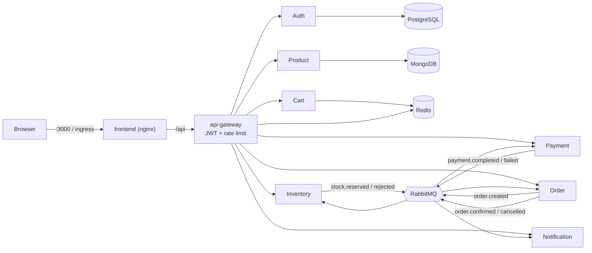

# ShopSphere

ShopSphere is a cloud-native e-commerce platform built for the CNA DevOps assignment. It has eight Spring Boot microservices behind an API gateway, a browser storefront, polyglot persistence, an event-driven order saga over RabbitMQ, Docker images, Kubernetes manifests, Terraform for AWS, and GitHub Actions for CI, CD and security scanning.

**Live demo:** http://3.7.14.126 (AWS EC2 + k3s, Mumbai). The server stops every night at 23:00 IST to save credits; start it with `terraform output -raw start_command`.

   

## Architecture



| Service | Responsibility | Store |
| --- | --- | --- |
| `frontend` | Storefront SPA (catalogue, cart, checkout, order timeline, notifications, platform health, admin) served by nginx, which proxies `/api` to the gateway | none |
| `api-gateway` | Single entry point; validates JWTs, enforces USER/ADMIN access, injects `X-User-Id`/`X-User-Role`, Redis rate limiting on `/api/auth` | Redis |
| `auth-service` | Register, login, `/me`; BCrypt passwords, signed JWTs, seeded admin | PostgreSQL |
| `product-service` | Catalogue search, categories, admin CRUD; seeds 12 demo products | MongoDB |
| `inventory-service` | Stock levels; reserves stock on `order.created`, releases it on `order.cancelled` (compensation) | in-memory ledger |
| `cart-service` | Per-user cart with 7-day TTL | Redis |
| `order-service` | Prices orders from the catalogue, starts and tracks the saga, keeps a step history | in-memory |
| `payment-service` | Mock card charge with Resilience4j retry and circuit breaker; orders above ₹50,000 are declined so the failure path can be shown | none |
| `notification-service` | Turns saga outcomes into user notifications | in-memory |
| `report-job` | Batch job run as a Kubernetes CronJob | none |
| `common-lib` | Shared event contracts, JWT helper, correlation-id filter, error handler | n/a |

**Order saga.** `POST /api/orders` returns `202 PENDING`. Inventory reserves stock, payment charges the card, and the order becomes `CONFIRMED`. If stock is short or payment is declined, the order becomes `CANCELLED` and inventory releases what it had reserved. The storefront shows each step live.

## Run it locally (Docker Compose)

Requirements: Docker Desktop (about 3 GB RAM free).

```bash
cp .env.example .env          # optional; defaults work for local use
docker compose up --build -d  # first build takes a few minutes
```

Open **http://localhost:3000**.

- Sign in as admin: `admin@shopsphere.local` / `Admin@12345` (admin tab lets you add products and change stock)
- Or register a new user, add products to the cart and check out.
- To show the compensation path, order more than ₹50,000 (payment declined) or more units than are in stock.

Other useful URLs: gateway `http://localhost:8080/actuator/health`, RabbitMQ console `http://localhost:15672`.

Run the end-to-end smoke test:

```bash
bash scripts/smoke-test.sh                    # macOS / Linux / Git Bash
powershell -File scripts/smoke-test.ps1       # Windows
```

Optional monitoring: `docker compose -f docker-compose.yml -f docker-compose.observability.yml up -d` (Prometheus on 9090, Grafana on 3001).

Stop with `docker compose down -v`.

## Run it on Kubernetes locally (kind)

Requirements: Docker, kind, kubectl.

```bash
bash scripts/kind-up.sh            # or: powershell -File scripts/kind-up.ps1
```

This creates the cluster from `scripts/kind-config.yaml`, builds and loads all images, applies `k8s/overlays/local` and waits for every rollout. Open **http://localhost:30080**.

Kubernetes features used (`k8s/base`): Deployments with readiness/liveness/startup probes, resource requests and limits, HorizontalPodAutoscalers and PodDisruptionBudgets, a CronJob, ConfigMap and Secrets (Kustomize `secretGenerator`), default-deny NetworkPolicies, Pod Security Standards `restricted` on the namespace, and hardened pods (non-root, read-only root filesystem, all capabilities dropped, seccomp `RuntimeDefault`).

## Deploy to AWS for a public link

Terraform in `infra/terraform` creates one small, cost-controlled environment:

- one `c7i-flex.large` EC2 instance (4 GiB, allowed on the AWS Free plan) in the default VPC running k3s, with an Elastic IP (no NAT gateway, no load balancer, no EKS)
- IAM role for SSM Session Manager (no SSH keys needed) and a GitHub OIDC role that can only run the deploy command
- AWS Budget alerts and a nightly stop schedule (23:00 IST)

```bash
cd infra/terraform
cp terraform.tfvars.example terraform.tfvars   # set budget_email
terraform init
terraform apply
terraform output app_url                        # the public link
```

The node pulls images from GHCR, so run the CD workflow once first and make the `shopsphere-*` packages public (GitHub, Packages, Package settings, Change visibility). See [infra/terraform/README.md](infra/terraform/README.md) for details and [docs/COST.md](docs/COST.md) for the cost estimate. If the link shows an error, `scripts/aws-diagnose.ps1` prints pod status, an admin login check and recent logs from the node through SSM. Run `terraform destroy` once you have been graded.

## CI/CD and DevSecOps

| Workflow | Trigger | What it does |
| --- | --- | --- |
| `ci.yml` | push, PR | Maven `verify` with unit tests and JaCoCo coverage, frontend syntax check, Compose validation, Kustomize render and `kubeconform` schema validation, plus sample Docker builds on PRs |
| `security.yml` | push, PR, weekly | Gitleaks secret scan, Trivy dependency scan and Trivy IaC misconfiguration scan (Dockerfiles, Kubernetes, Terraform) with SARIF upload to GitHub code scanning, dependency review on PRs |
| `codeql.yml` | push, PR, weekly | CodeQL static analysis for Java and JavaScript |
| `cd.yml` | push to `master`/`main` | Builds all 10 images, scans each with Trivy (fails on any fixable HIGH or CRITICAL CVE), pushes to GHCR, then deploys to EC2 through SSM when `AWS_DEPLOY_ROLE_ARN` and `EC2_INSTANCE_ID` repository variables are set |
| `terraform.yml` | changes in `infra/` | `terraform fmt`, `init` and `validate` |

Security controls in the code: JWT validation at the gateway, header-spoofing protection, role-based access, BCrypt, rate limiting, CSP and security headers on the frontend, non-root containers, patched dependency versions pinned in the parent `pom.xml`, secrets kept out of git (`.env`, `secrets.env`, SSM SecureString on AWS).

## Assignment rubric mapping

| Criterion | Where to look |
| --- | --- |
| Microservices (3) | `services/*`, `common-lib`, saga in `order-service` / `inventory-service` / `payment-service`, gateway in `api-gateway` |
| Docker (4) | Multi-stage `Dockerfile` (layered jars, non-root, BuildKit cache), `frontend/Dockerfile`, `docker-compose.yml` with healthchecks and memory limits |
| IaC (2) | `infra/terraform` (EC2 + k3s, IAM, OIDC, budgets, scheduler) |
| Kubernetes (2) | `k8s/base`, `k8s/overlays/local`, `k8s/overlays/aws`, `scripts/kind-up.*` |
| CI/CD pipeline (3) | `.github/workflows/ci.yml`, `cd.yml`, `terraform.yml` |
| DevSecOps (2) | `.github/workflows/security.yml`, `codeql.yml`, Trivy image scan in `cd.yml`, hardened manifests |
| Cloud provider / local machine (2) | AWS EC2 via Terraform; local Docker Compose and kind |
| Public link (2) | `terraform output app_url` |

## Repository layout

```
common-lib/            shared contracts and web/messaging auto-configuration
services/              eight microservices and the report job
frontend/              storefront SPA and nginx config
k8s/                   Kustomize base and local / aws overlays
infra/terraform/       AWS infrastructure
.github/workflows/     CI, CD, security, CodeQL, Terraform
scripts/               kind, deploy, smoke, chaos and load-test helpers
load-tests/            k6 scenario
docs/                  architecture, cost, demo script, ADRs
```

See [docs/demo-script.md](docs/demo-script.md) for a walkthrough and [the Git workflow](docs/git-workflow.md) for branch and PR conventions.
