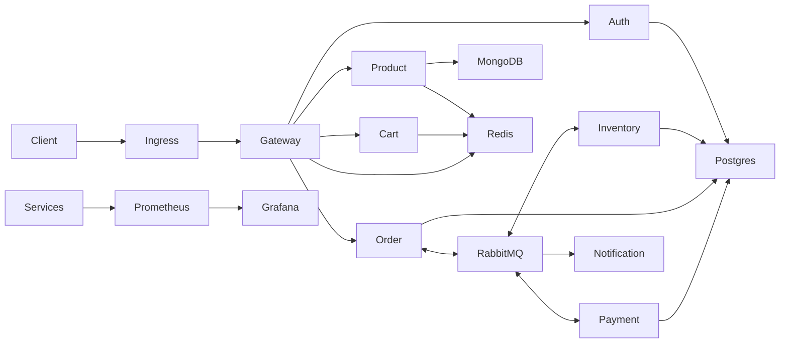

# Architecture

ASCII fallback: `Client -> Ingress -> Gateway -> services; Order <-> RabbitMQ <-> Inventory/Payment -> Notification; PostgreSQL per SQL service, MongoDB for product, Redis for cart/cache/rate limits.`

| Service | Owner datastore |
| --- | --- |
| auth, inventory, order, payment | Separate PostgreSQL database per service |
| product | MongoDB |
| cart, product cache, gateway limiter | Redis |
| notification, gateway, report job | No primary datastore |

Local runs Docker Compose/kind. AWS uses ECR + small ECS Fargate demo services and one temporary k3s EC2 node; no NAT Gateway.
