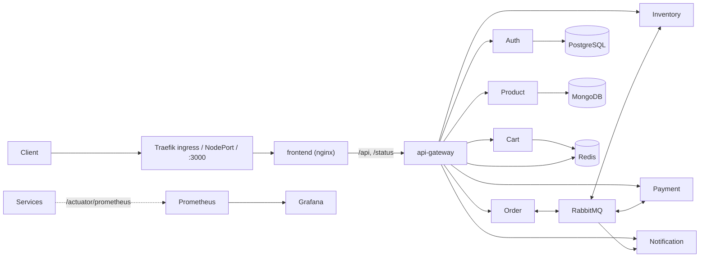

# Architecture

ASCII fallback: `Client -> frontend (nginx) -> gateway -> services; Order <-> RabbitMQ <-> Inventory/Payment -> Notification; PostgreSQL for auth, MongoDB for product, Redis for cart and gateway rate limits.`

## Request path

1. The browser loads the SPA from nginx. nginx proxies `/api/*` and `/status/*` to `api-gateway`, so the browser only talks to one origin.
2. The gateway checks the route's access level (public, user, admin), validates the JWT issued by `auth-service`, removes any client-supplied `X-User-*` headers and sets trusted `X-User-Id` and `X-User-Role` headers.
3. Services trust those headers; they are not reachable from outside the cluster (NetworkPolicies allow ingress only from the gateway).
4. Every request carries `x-request-id`; `common-lib` puts it in the logging MDC as `correlationId` and propagates it into saga events.

## Order saga (choreography over a topic exchange `shopsphere.events`)

| Step | Publisher | Event | Consumer reaction |
| --- | --- | --- | --- |
| 1 | order | `order.created` | inventory reserves stock |
| 2a | inventory | `stock.reserved` | payment charges the card |
| 2b | inventory | `stock.rejected` | order is cancelled |
| 3a | payment | `payment.completed` | order is confirmed |
| 3b | payment | `payment.failed` | order is cancelled |
| 4 | order | `order.confirmed` / `order.cancelled` | notification informs the user; on cancel, inventory releases reserved stock |

Reservation and release are idempotent per order id, so redelivered messages are safe. Payment uses Resilience4j retry and a circuit breaker.

## Data ownership

| Service | Store |
| --- | --- |
| auth | PostgreSQL (`users` table) |
| product | MongoDB (`products` collection) |
| cart, gateway rate limiter | Redis |
| inventory, order, notification | in-memory (demo scope) |
| payment, report job | none |

## Environments

| Environment | How | Entry point |
| --- | --- | --- |
| Local Compose | `docker compose up --build -d` | http://localhost:3000 |
| Local Kubernetes | `scripts/kind-up.*`, overlay `k8s/overlays/local` | http://localhost:30080 |
| AWS | `infra/terraform` creates one EC2 node running k3s; CD pushes images to GHCR and redeploys through SSM; overlay `k8s/overlays/aws` | `terraform output app_url` |
